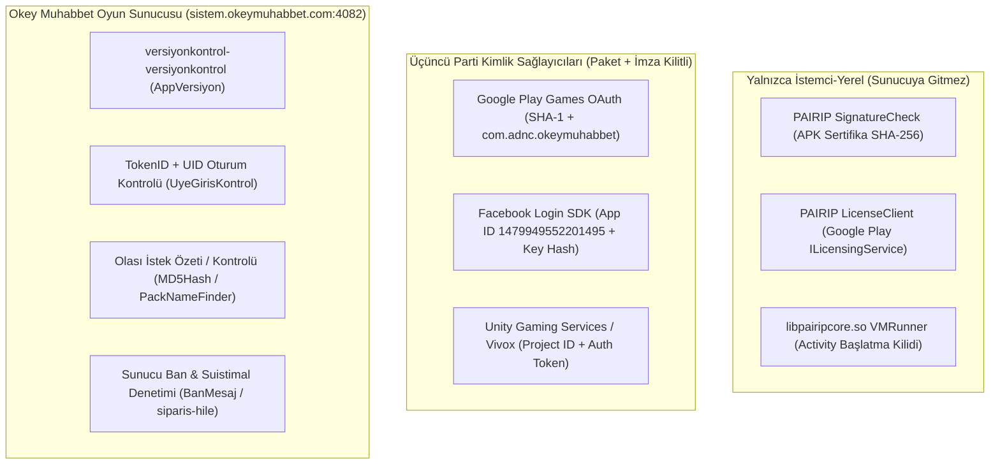

# Okey Muhabbet (`com.adnc.okeymuhabbet`) — Kimlik Doğrulama, Oturum ve Bütünlük Analizi

**Tarih:** 17.11.2026  
**Kaynak Kanıtlar:** `AndroidManifest.xml` (`ev_dee606b2b663c1d4...`), JADX DEX Taramaları (`ev_bce20d9021b7e540...`, `ev_887174815c0b126f...`, `ev_94bf5bf9d918db5d...`), `ScriptingAssemblies.json`, `global-metadata.dat` (v106)

---

## 1. Desteklenen Giriş Yöntemleri ve Bağımsız İstemci Uyumluluğu

Orijinal uygulamada tespit edilen tüm kimlik doğrulama kanalları ve bunların bağımsız bir Android istemcisinde kullanılabilirlik durumu aşağıdadır:

| Giriş Yöntemi | Sunucu Komutu | İstemci SDK / Sınıfı | Bağımsız İstemcide Durum | Güvenirlik |
|---|---|---|---|---|
| **Misafir Girişi** | `giris-misafir` | `SuNetwork.MisafirGirisi`, `GameUniqueID`, `MacAdresiGonder` | Teknik olarak çağrılabilir; ancak sunucu sürüm/cihaz kontrolü ve ToS izni gerekir | `[KANITLANDI]` |
| **Google Play Games** | `giris-googlegirisyeni` | `Google.Play.Games.dll` (`InitializePlayGamesLogin`, `LoginGoogle`) | **ENGEL:** Google Cloud OAuth istemcisi `com.adnc.okeymuhabbet` paket adı ve `1e9f627e...` imzasına kilitlidir | `[KANITLANDI]` |
| **Facebook Girişi** | `giris-facebookgiris` | `Facebook.Unity.dll` (`FacebookGiris`, App ID `1479949552201495`) | **ENGEL:** Meta Developer konsolunda paket adı + imzalama anahtarı (Key Hash) kaydı zorunludur | `[KANITLANDI]` |
| **Apple ile Giriş** | `giris-applegiris` | `AppleAuth.dll` (`LoginToApple`) | Android'de web OAuth akışı ve geliştirici Service ID yönlendirmesi gerektirir | `[KANITLANDI]` |
| **Klasik Üye / Hesap Tespiti** | `giris-GirisYap` / `giris-LoginDetectAccount` | `GirisIcerik`, `uye-GirisKayit`, `MergeAccount` | JSON şeması ve olası parola/cihaz özeti (`MD5Hash`) şartnamesi gerektirir | `[GÜÇLÜ İPUCU]` |

---

## 2. Oturum Yönetimi ve Cihaz Bağlama Mekanizmaları

### 2.1 Oturum Kimlik Bilgileri (`UID` & `TokenID`)
- **`[KANITLANDI]`** Başarılı giriş (`OnGirisYapildi` veya `OnMisafirGirisi`) sonrasında istemci belleğinde `UID` (`get_uid`) ve `TokenID` (`get_token`, `token_id`, `session_token`) saklanır; log format sabiti `{{ token = {0}, uid = {1} }}` olarak `global-metadata.dat` içinde doğrulanmıştır.
- **`[KANITLANDI]`** Oturum başlatıldıktan sonra `AfterLoginSystems` devreye girer:
  1. `oyunbilgileri-bilgileriyukle` ile oyuncu profili ve lobi yapılandırması çekilir,
  2. `giriskontrol-UyeGirisKontrol` ve `uyecron-cronmasa` ile oturumun tekilliği ve canlılığı korunur,
  3. `firebase-FireBaseToken` ile bildirim jetonu ve `VivoxUserLogin` (`VivoxLoginId`) ile sesli sohbet oturumu açılır.

### 2.2 Cihaz Kimliği ve Hesap Birleştirme (`MergeAccount`)
- **`[KANITLANDI]`** Uygulama misafir hesaplarını cihazda kalıcı tutmak ve çoklu hesapları yönetmek için şu bileşenleri içerir:
  - `GameUniqueID` (Unity `SystemInfo.deviceUniqueIdentifier` tabanlı cihaz kimliği `[GÜÇLÜ İPUCU]`),
  - `MacAdresiGonder` / `MacAddressBul` -> `oyun-mackayit` komutu,
  - `LoginDetectAccount` / `MultipleAccountPanel` (`GenerateAccounts`),
  - `oyuncu-AccountMergeNative` (`MergePayload`: `merge_uid`, `merge_gid`).
- **`[GÜÇLÜ İPUCU]`** Android 10+ (ve test cihazındaki Android 16 / SDK 36) üzerinde donanımsal MAC adresine erişim işletim sistemi tarafından kısıtlandığından, `MacAddressBul` metodunun geri dönüş (fallback) değeri veya `deviceUniqueIdentifier` ürettiği değerlendirilmektedir; tam üretim mantığı **`[BİLİNMİYOR]`** statüsündedir.

---

## 3. Sunucu Tarafı İstemci Doğrulama ve Attestation Analizi

### 3.1 Doğrulanmış Attestation Yoklukları (`[KANITLANDI]`)
1. **Google Play Integrity API Yoktur:** `search_android_classes(query="integrity")` (`ev_bce20d9021b7e540...`) sonucunda hiçbir `com.google.android.play.core.integrity` sınıfı bulunmamıştır; `ScriptingAssemblies.json` içinde `Google.Play.Integrity.dll` mevcut değildir.
2. **Firebase App Check Yoktur:** `search_android_classes(query="appcheck")` (`ev_887174815c0b126f...`) 0 eşleşme döndürmüştür; `Firebase.Auth.dll` de projede yer almamaktadır.
3. **PAIRIP Oyun Sunucusundan Bağımsızdır:** `com.pairip.licensecheck` içinde oyun sunucusuna gönderilen herhangi bir attestation jetonu üretilmez; PAIRIP yalnızca Google Play dışı APK kurulumlarında uygulamayı yerel olarak kapatır (`ev_3dbc255211b7ee36...`).

### 3.2 Sunucu Tarafında Karşılaşılacak Gerçek Kimlik ve Doğrulama Engelleri
1. **Sosyal Hesap OAuth Sertifika Kilidi (`[KANITLANDI]`):**  
   Mevcut oyuncuların büyük bölümü altın, seviye (`UyeSeviye`), VIP durumu ve envanterlerini Google Play Games veya Facebook hesaplarında tutmaktadır. Bağımsız bir Android istemcisi:
   - `com.adnc.okeymuhabbet` paket adını kullansa dahi geliştiricinin özel anahtarıyla (`1e9f627e...`) imzalanamayacağı için Google Play Services `DEVELOPER_ERROR` döndürür ve oturum açmayı reddeder.
   - Farklı bir paket adı (`com.ornek.okeyistemci`) kullansa, geliştirici Google Cloud ve Meta konsollarına bu yeni paket adını ve SHA-1 özetini kaydetmediği sürece yine OAuth jetonu alamaz.
2. **İstemci Sürüm ve Paket Kontrolü (`[KANITLANDI]` / `[GÜÇLÜ İPUCU]`):**  
   `Assembly-CSharp.dll` içinde `versiyonkontrol-versiyonkontrol`, `AppVersiyon` ve `PackNameFinder` (`PackNames`) yer almaktadır. Sunucu eski veya tanınmayan istemci sürüm bildirimlerinde `OnOyunuGuncelle` / `OnVersiyonMesaj` döndürerek girişi engelleyebilir.
3. **`MD5Hash` İstek/Oturum Doğrulama İhtimali (`[GÜÇLÜ İPUCU]` / `[BİLİNMİYOR]`):**  
   `OyunMotoru` içinde `MD5Hash` ve `UnixTime` fonksiyonlarının bir arada bulunması, giriş veya kritik komutlarda `MD5(parametreler + gizli_tuz)` biçiminde bir bütünlük özeti hesaplanıyor olabileceğine işaret eder. Gizli tuzun varlığı ve formülü yetkili geliştirici dokümantasyonu olmadan bilinemez.
4. **Vivox Sesli Sohbet Kimlik Doğrulaması (`[KANITLANDI]`):**  
   Masa içi sesli sohbet (`VivoxControl`), `Unity.Services.Authentication` ve Vivox proje anahtarlarıyla oturum açar (`VivoxUserLogin`). Geliştirici proje yetkisi olmadan bağımsız istemci ses kanallarına katılamaz.
