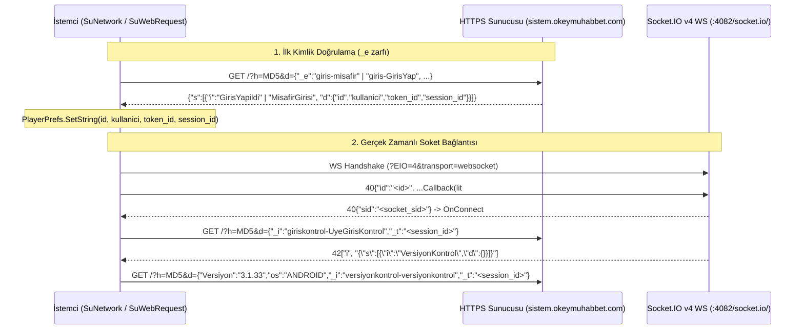

# KİMLİK DOĞRULAMA AKIŞ İZİ VE SUNUCU KONTROLLERİ (`AUTHENTICATION-FLOW-TRACE.md`)

> **Kapsam:** `com.adnc.okeymuhabbet` (`v3.1.33`) içinde misafir girişi (`giris-misafir`), kayıtlı/sosyal giriş (`Giris`, `FacebookGiris`, `LoginGoogle`, `AppleLogin`), oturum saklama (`PlayerPrefs`), cihaz tanımlayıcıları (`GameUniqueID`, `MacAddressBul`) ve sunucu kontrollerinin (`PackNameFinder`, `AppVersiyon` / `OnVersiyonKontrol`, `MD5Hash`, `UnixTime`, PAIRIP) RVA ve Ghidra decompile kanıtlarıyla uçtan uca izi.

---

## 1. Misafir Oturumu (`giris-misafir`) Uçtan Uca İzi

### 1.1 `giris-misafir` Gerçekten Çalışan Bir Giriş Akışında mı Kullanılıyor?
- **Statik Kod ve Sahne Bağlantısı (`KANITLANDI`):**
  - `SuNetwork.MisafirGirisi()` (`RVA 0x019B2B0C`, `Method[59966]`, `rid=1000`) `Assembly-CSharp.dll` içinde herhangi bir C# metodundan doğrudan `BL` ile çağrılmaz (`0 direct code callers`).
  - Ancak `data.unity3d` açıldığında `resources.assets+0x70315C` (akış ofseti `0xC0951D`) konumundaki Unity UI `Button` bileşeninde şu serileştirilmiş `UnityEvent` kaydı yer almaktadır:
    - `m_Interactable = 1` (`0xC094F4`)
    - `m_Target = (fileID: 0, pathID: 0x37B9)`
    - `m_MethodName = "MisafirGirisi"` (`0xC0951C`)
    - `m_CallState = 2` (`UnityEventCallState.RuntimeOnly`, `0xC09570`)
  - Ayrıca `SuNetwork.Start()` (`RVA 0x019ABDB0`) içinde sunucudan dönen `'MisafirGirisi'` (`lit#6741`) ve `'MisafirGirisBildirim'` (`lit#6739`) olayları `SuWebRequest.On` sözlüğüne aktif olarak kaydedilmektedir.
- **Canlı Sunucu Kabul Durumu (`BİLİNMİYOR` / `ENGELLENDİ`):**
  - Etik çalışma sınırları gereği canlı üretim sunucusuna (`https://sistem.okeymuhabbet.com/`) izinsiz HTTP isteği gönderilmemiştir. Dolayısıyla sunucu tarafının `v3.1.33` sürümünde `_e = "giris-misafir"` isteğine yeni oturum açıp açmadığı, yoksa `MisafirGirisBildirim` / `GirisYapilamadi` ile misafir girişini kısıtlayıp kısıtlamadığı yalnızca yetkili canlı testte doğrulanabilir.
- **İsim Benzerliği Tuzağının Giderilmesi (`KANITLANDI`):**
  - Kod tabanında görülen `MisafirIcerik` (`RVA 0x01991984`) ve `MisafirKonusma` (`RVA 0x01991E7C`) sınıfları **misafir hesabı girişi değildir**; oyun masasına izleyici olarak katılan konukların Vivox sesli sohbet durumunu (`VivoxParticipant.get_IsMuted @ RVA 0x03253100`, `'Allowed Guests'`, `'SesiAc'`, `'SesiKapat'`) yöneten masa içi bileşenlerdir.

### 1.2 `SuNetwork.MisafirGirisi()` Hangi Metotları Çağırır ve Ne Gönderir? (`KANITLANDI`)
`RVA 0x019B2B0C..0x019B2CE8` ARM64 komut ve Ghidra decompile izi:

1. `OyunMotoru.PanelAc("LoadingMini", false)` (`BL 0x01982C78`, `lit#6396`).
2. `new JSONObject(JSONObject.Type.OBJECT)` (`BL 0x019C2AD4`).
3. `JSONObject.AddField("token_id", PlayerPrefs.GetString("token_id"))` (`0x019B2C28`, `lit#15821`).
4. `JSONObject.AddField("device_id", Login.Instance.GameUniqueID)` (`0x019B2C74`, `lit#12617`).
5. `mac = SuNetwork.MacAddressBul()` (`BL 0x019B1158`) -> `machash = OyunMotoru.MD5Hash(mac)` (`BL 0x01996CA8`) -> `JSONObject.AddField("machash", machash)` (`0x019B2C94`, `lit#14153`).
6. `JSONObject.AddField("_e", "giris-misafir")` (`0x019B2CA8`, `lit#11436`, `lit#13334`).
7. `SuWebRequest.Emit(Data)` (`B 0x019C2C64`) -> `HTTPS GET https://sistem.okeymuhabbet.com/?h=<md5>&d=<json>`.

**Gönderilen Tam JSON Modeli:**
```json
{
  "token_id": "<varsa_onceki_token_id_veya_bos>",
  "device_id": "<SystemInfo.deviceUniqueIdentifier>",
  "machash": "<MD5(MacAddressBul())>",
  "_e": "giris-misafir"
}
```
*(Not: `PlayerPrefs` içinde önceden kayıtlı bir `"session_id"` varsa `<Send>d__27.MoveNext @ RVA 0x019C6374` ayrıca `"_t"` alanını ekler.)*

### 1.3 Beklenen Sunucu Yanıt Modeli (`SuNetwork.OnMisafirGirisi @ RVA 0x019B2CE8`) (`KANITLANDI`)
`decompiled_targets.c` satır `6482-6577` incelemesine göre sunucu `{"s": [{"i": "MisafirGirisi", "d": {...}}]}` yanıtı döndürdüğünde `OnMisafirGirisi(JSONObject data)` şu alanları bekler ve `PlayerPrefs` içine kaydeder:

```json
{
  "id": "<Oyuncu_Sayisal_ID>",
  "kullanici": "<Kullanici_Adi>",
  "token_id": "<Kalici_Hesap_Tokeni>",
  "session_id": "<Aktif_Oturum_Tokeni>"
}
```
- `data["id"]` boş/null ise metot erken döner (`if (lVar3 == 0) return;`).
- Doluysa sırasıyla `PlayerPrefs.SetString("id", ...)`, `PlayerPrefs.SetString("kullanici", ...)`, `PlayerPrefs.SetString("token_id", ...)`, `PlayerPrefs.SetString("session_id", ...)` ve `PlayerPrefs.Save()` (`0x035E84C0`) çağrılır; ayrıca `SuNetwork` statik kullanıcı verisi (`offset +0x30`) güncellenir.

---

## 2. Kayıtlı / Sosyal Giriş ve Oturum Yaşam Döngüsü (`KANITLANDI`)



### 2.1 `UID` ve `TokenID` Yanılgısının Düzeltilmesi (`KANITLANDI`)
- **`TokenID`:** `global-metadata.dat` taraması (`Sec[10] Parameters`, `elem=62207`) `TokenID` adının yalnızca `SuNetwork.FireBaseToken(string TokenID)` (`Method[60166]`, `RVA 0x019B229C` — push bildirim FCM token kaydı) metodunun parametre adı olduğunu kanıtlamıştır.
- **`UID`:** `Sec[11] Fields` (`Field[29902]`) taraması `UID` alanının yalnızca `<ResimCek>d__299` (`Type[7322]`) profil resmi indirme coroutine'ine ait olduğunu kanıtlamıştır.
- **Gerçek Oturum Saklama Mekanizması:** Oturum kimlikleri `UnityEngine.PlayerPrefs` üzerinde açık metin anahtarlarıyla tutulur:
  1. `"id"`: Oyuncu benzersiz kimliği (`SuWebRequest.Callback` içinde Socket.IO el sıkışmasında kullanılır).
  2. `"token_id"`: Yeniden giriş anahtarı (`SuNetwork.Giris @ RVA 0x019B1940` içinde `{"machash": ..., "token_id": PlayerPrefs["token_id"], "_e": "giris-GirisYap"}` olarak gönderilir).
  3. `"session_id"`: Aktif oturum bileti (`<Send>d__27.MoveNext @ RVA 0x019C6374` ve `<SendPost>d__26.MoveNext @ RVA 0x019C6758` tarafından her isteğe otomatik olarak **`"_t"`** adıyla eklenir).
  4. `"kullanici"`: Oyuncu görünen adı.
  - Giriş başarısız olduğunda `SuNetwork.OnGirisYapilamadi` (`RVA 0x019B1AB4`) `PlayerPrefs.DeleteKey` (`0x034E828C`) ile bu dört anahtarı siler ve `'Giris'` panelini açar (`KANITLANDI`).

### 2.2 `GameUniqueID` ve MAC Adresi Amaçları (`KANITLANDI`)
- **`Login.Instance.GameUniqueID` (`Field[29220]`):** `Login` (`Type[7202]`) sınıfının `Awake` (`RVA 0x0197F0D4`) metodunda `UnityEngine.SystemInfo.get_deviceUniqueIdentifier()` (`RVA 0x034F8488`) çağrısıyla üretilir; Android'de `Settings.Secure.ANDROID_ID` tabanlı cihaz kimliğidir ve `MisafirGirisi` içinde `"device_id"` olarak gönderilir.
- **`SuNetwork.MacAddressBul()` (`RVA 0x019B1158`):** `System.Net.NetworkInformation.NetworkInterface.GetAllNetworkInterfaces()` (`RVA 0x02FED3A0`) ile ilk ağ arayüzünün fiziksel adresini okur ve `OyunMotoru.MD5Hash` ile özetleyerek `"machash"` üretir. Bu değer **4 metotta** kullanılır (`KANITLANDI`):
  1. `SuNetwork.LoginDetectAccount(id)` (`RVA 0x019B0FE4`, `_e: "giris-LoginDetectAccount"`) -> aynı cihazdaki çoklu hesapları (`MultipleAccountPanel`) tespit etmek için.
  2. `SuNetwork.Giris()` (`RVA 0x019B1940`, `_e: "giris-GirisYap"`).
  3. `SuNetwork.MisafirGirisi()` (`RVA 0x019B2B0C`, `_e: "giris-misafir"`).
  4. `SuNetwork.MacAdresiGonder()` (`RVA 0x019C2184`, `_i: "oyun-mackayit"`, `0` çağrıcı — atıl metot).

### 2.3 Sosyal Girişlerin Alternatif İstemci Açısından Durumu (`KANITLANDI` kod / `GÜÇLÜ İPUCU` kısıt)
- **Google Play Games (`Login.LoginGoogle @ RVA 0x0197F168` -> `OnGoogleLogin @ RVA 0x0197F264`):** Google Play Games Hizmetleri, Android paket adını (`com.adnc.okeymuhabbet`) ve geliştirici imzalama sertifikasının SHA-1 parmak izini Google Cloud tarafında doğrular. Bağımsız bir APK resmi geliştirici anahtarıyla imzalanamayacağı için Google Play Games OAuth akışı bağımsız istemcide **çalışmaz** (`GÜÇLÜ İPUCU`).
- **Facebook Login (`FacebookLogin.FacebookGiris @ RVA 0x0197E6BC` -> `<FacebookGirisOk>b__2_0 @ RVA 0x0197EB6C`):** Facebook Android SDK da Facebook sunucularında paket adı ve Key Hash kontrolü yapar (`GÜÇLÜ İPUCU`).

---

## 3. Sunucu Kontrollerinin Kesin Denetimi

### 3.1 `OyunMotoru.PackNameFinder` Giriş Akışında Kullanılıyor mu? (`KANITLANDI`: HAYIR)
- **Adres:** `RVA 0x01997F3C` (GhidraVA `0x01A97F3C`, `decompiled_targets.c` satır `12502-12648`).
- **Çağrıcı Sayısı:** `Assembly-CSharp.dll` genelindeki `2.610` metodun tamamı tarandığında **`0` çağrıcı** (`BL`/`B` veya delege referansı yok).
- **Gerçek İşlevi:** `this->PackNames` (`Field[29533]`, `List<string>`) içindeki elemanları `'-'` karakteriyle böler (`String.Split('-')`), `parca[0] == key && parca[1] == sys` eşleşirse `parca[2]` döndürür. Android uygulama paket adıyla (`Application.identifier`) hiçbir ilgisi yoktur.

### 3.2 `AppVersiyon` ve Sürüm Kontrolü Nasıl Çalışıyor? (`KANITLANDI`)
- **`AppVersiyon` (`TypeDefinition[7392]`):** `AppVersiyon.Start` (`RVA 0x019DD10C`) yalnızca `GetComponent<TMP_Text>()` alıp `Application.get_version()` (`0x034BD96C`) değerini ekrana yazan yerel bir arayüz bileşenidir.
- **Gerçek Sunucu Sürüm Kontrolü (`SuNetwork.OnVersiyonKontrol @ RVA 0x019B0E70`):** Sunucu `'VersiyonKontrol'` olayı gönderdiğinde istemci şu komutu yollar:
  ```json
  {
    "Versiyon": "3.1.33",
    "os": "ANDROID",
    "_i": "versiyonkontrol-versiyonkontrol",
    "_t": "<session_id>"
  }
  ```
  Sunucu bu sürümü eski bulursa `'VersiyonMesaj'` (`OnVersiyonMesaj @ RVA 0x019BEB74`) veya `'OyunuGuncelle'` olayıyla istemciyi Play Store sayfasına (`SuNetwork.GuncelleGit @ RVA 0x019B3BBC`) yönlendirir.

### 3.3 `OyunMotoru.MD5Hash` ve `OyunMotoru.UnixTime` Tam Çağrıcı Dökümü (`KANITLANDI`)

`Assembly-CSharp.dll` içindeki tüm metotların ARM64 komut taramasıyla `OyunMotoru.MD5Hash` (`RVA 0x01996CA8`) metodunun **17 çağrı noktasının tamamı** çıkarılmıştır:

| Kategori | Çağıran Metot & RVA | MD5Hash Girdisi ve Amacı |
|---|---|---|
| **1. Ağ İstek İmzası (Kritik)** | `<Send>d__27.MoveNext` (`RVA 0x019C6374`) | `MD5(jsonStr + <REDACTED_16CHAR_STATIC_SALT>)` (`lit#1429`) -> Tüm HTTPS GET isteklerinde `?h=` doğrulama imzası. |
| **2. İstemci Mükerrer İstek Engeli** | `SuWebRequest.Emit` (`RVA 0x019C2C64`) | `MD5(Data.ToString())` + satır içi `DateTime.UtcNow` -> Aynı JSON'un 2 saniye içinde tekrar gönderilmesini engeller. |
| **3. Cihaz MAC Özeti (`machash`)** | `LoginDetectAccount` (`0x019B0FE4`), `Giris` (`0x019B1940`), `MisafirGirisi` (`0x019B2B0C`), `MacAdresiGonder` (`0x019C2184`) | `MD5(MacAddressBul())` -> `"machash"` alanı. |
| **4. Mağaza Sipariş Doğrulaması** | `SiparisKayit` (`0x019BCB94`), `SiparisHediye` (`0x019BCF98`), `SiparisHediyeYolu` (`0x019BD2F8` x2), `SiparisUyelik` (`0x019BD8F4`) | Satın alma parametreleri + gömülü sipariş tuzu (`lit @ 0x019BCB94`, `<REDACTED_ORDER_SALT>`). |
| **5. Apple Giriş & Görsel Önbellek** | `AppleLogin.<LoginToApple>b__11_0` (`0x0197DD04`), `<ResimGoster>d__57.MoveNext` (`0x01999158` x4), `<ResimCek>d__299.MoveNext` (`0x019C2EF0`) | Kimlik dizgisi ve uzak profil/avatar URL'lerinden yerel önbellek dosya adı üretimi. |

`OyunMotoru.UnixTime()` (`RVA 0x01997374`) ise doğrudan yalnızca **1 metottan** çağrılır: `OyunMotoru.VideoReklamGosterildi()` (`RVA 0x0199743C` — ödüllü reklam bekleme süresi kontrolü). `SuWebRequest.Emit` kendi `DateTime.UtcNow` hesabını satır içi (`0x02C171AC` -> `0x02C1BFAC`) yapar; giden JSON paketlerine açık bir `UnixTime` alanı **eklenmez** (`KANITLANDI`).

### 3.4 PAIRIP, Paket Adı ve İstemci Doğrulaması Özeti (`KANITLANDI`)
1. **PAIRIP (`com.pairip.licensecheck` + `libpairipcore.so`):** Ghidra ELF yükleyici çıktısında doğrulandığı üzere `libil2cpp.so`, `libpairipcore.so` kütüphanesine `DT_NEEDED` (`ExecuteProgram` sembolü) ile bağlıdır ve `LicenseClient` Google Play `com.android.vending` lisans kontrolü başarısız olduğunda orijinal uygulamayı yerel olarak `System.exit(0)` ile kapatır. **Ancak PAIRIP oyun sunucusuna (`sistem.okeymuhabbet.com`) hiçbir token, başlık veya imza göndermez (`KANITLANDI`).**
2. **Sunucu Tarafı İstemci Doğrulaması Kanıtları (`KANITLANDI`):**
   - Ağ katmanındaki istemci doğrulaması **üç hafif mekanizmadan** oluşur:
     1) HTTPS GET `?h=` MD5 tuz imzası (`lit#1429`),
     2) Socket.IO `/` ad alanı bağlantı el sıkışma dizgisi (`SuWebRequest.Callback`, `lit#399`),
     3) `versiyonkontrol-versiyonkontrol` içindeki `"Versiyon": "3.1.33"` ve `"os": "ANDROID"` alanları.
   - Ağ katmanında **paket adı (`com.adnc.okeymuhabbet`), APK v2/v3 sertifika özeti veya Google Play Integrity JWS token'ı gönderildiğine dair sıfır kanıt vardır (`KANITLANDI`).**
