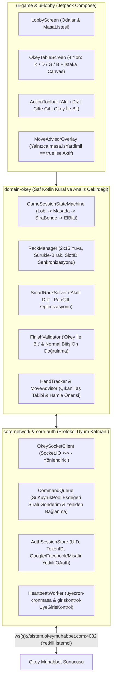

# Okey Muhabbet — Koşullu Bağımsız Android İstemcisi Mimari Önerisi

**Tarih:** 17.11.2026  
**Uygulama Koşulu (`SONUÇ B`):** Bu mimari önerisi, [BLOCKERS-AND-REQUIREMENTS.md](file:///e:/apk/test-okey/BLOCKERS-AND-REQUIREMENTS.md) belgesinde listelenen geliştirici (`MANC` / `ADNC`) izni, istemci kaydı ve protokol şeması onayları karşılandığında hayata geçirilecek hedef teknik tasarımı tanımlar. Geliştirici onayı olmadan üretime karşı kod geliştirilmemeli ve canlı sunucuya bağlanılmamalıdır.

---

## 1. Mimari Tasarım İlkeleri ve Teknoloji Yığını

Orijinal uygulamanın `SuNetwork` + `SuSistem.Masa` yapısı (`[KANITLANDI]`) ile birebir protokol uyumluluğu sağlarken, yüksek performanslı yerel bir Android deneyimi sunmak için önerilen teknoloji yığını:

- **Dil ve Eşzamanlılık:** Kotlin `2.x` + Kotlin Coroutines & `StateFlow` (tek yönlü veri akışı — UDF).
- **Kullanıcı Arayüzü:** Jetpack Compose + Özel 2B `Canvas` İstaka/Taş Çizim Katmanı (120 Hz Xiaomi 17T Pro ekranlarında akıcı sürükle-bırak taş animasyonları için).
- **Gerçek Zamanlı Protokol Katmanı:** Resmi `io.socket:socket.io-client` (Engine.IO / Socket.IO v3–v4 uyumlu; orijinaldeki `Firesplash.GameDevAssets.SocketIOPlus.dll` istemcisinin doğrudan protokol eşdeğeri `[KANITLANDI]`) + `OkHttp` WebSocket taşıyıcısı.
- **JSON ve Yardımcı Ağ Katmanı:** `kotlinx.serialization.json` + `Ktor` / `OkHttp` (`SuWebRequest.SendPost` eşdeğeri).
- **Sesli Sohbet (Opsiyonel / Yetkiyle):** Resmi Vivox Android SDK (`VivoxControl` eşdeğeri `[KANITLANDI]`).

---

## 2. Modüler İstemci Mimarisi

---

## 3. Çekirdek Modüllerin Teknik Karşılıkları

### 3.1 `core-network` — Socket.IO ve Komut Kuyruğu (`SuNetwork` Eşdeğeri)
- **`[KANITLANDI]`** Orijinal istemcideki `SuNetwork` + `SuKuyrukPool` davranışını korur:
  - Bağlantı koptuğunda `canReconnect` mantığıyla otomatik yeniden bağlanır ve `giriskontrol-UyeGirisKontrol` + `masakontrol-masakontrol` ile aktif masaya geri döner.
  - Sunucudan gelen `OnIstakayiGuncelle`, `OnMasaTaslariGuncelle`, `OnTasCek`, `OnTasAt`, `SiraGeldi`, `OnOyunBitir` ve `OnOyunBitirHata` olaylarını tipli (`sealed interface ServerEvent`) akışlara dönüştürür.
  - Periyodik `uyecron-cronmasa` ve `oyun-oyunpause` sinyallerini sunucunun beklediği zaman aralıklarında iletir (`[GÜÇLÜ İPUCU]`).

### 3.2 `domain-okey` — Taş, İstaka ve Hedeflenen 4 Ana Özellik

#### A. Oyun Taşlarının ve El Durumunun Yönetimi (`RackManager`)
- **`[KANITLANDI]`** Orijinal `Tas_Object` modeline (`TasID`, `TasRenk`, `TasSayi`, `Okeymi`, `TasIslek`, `SlotID`) birebir sadık kalır:
  - 106 taş (4 renk × `1..13` × 2 kopya + 2 Sahte Okey) değişmez (`data class Tile`) değer nesneleri olarak tutulur.
  - İstaka 2 satır (`Üst: 0..14`, `Alt: 15..29`) olarak modellenir; yerel taş kaydırma (`TasiTasi` / `TasSlotDegistir`) sıfır gecikmeyle istemcide yapılır, sunucuya yalnızca gerekli senkronizasyon anlarında (`masaseridiz-perdiz`, `masatasat-tasat`, `tournament-sendmyhand`) bildirilir.

#### B. Akıllı Diz (`SmartRackSolver`)
- **`[KANITLANDI]`** Orijinal uygulamadaki `MasaPerHesaplayici` (`PerSeriTasSorgula`, `PerRenkTasSorgula`, `PerOkeyKontrol`, `HesaplaKalanToplam`) ile uyumlu ancak dinamik programlama / dal-sınır (branch-and-bound) tabanlı optimal çözücü:
  1. **Seri/Grup Modu:** Eldeki 14/15 taşı, Okey (`Okeymi == true`) taşlarını en yüksek puanlı eksik taşların yerine koyacak şekilde ayrık perlere böler ve per dışı kalan taşların sayı toplamını (`PerDisiTasToplami`) **minimuma** indirir.
  2. **Çift Modu (`masacift-ciftegit`):** En fazla çift sayısını (`ciftGruplari`) üretecek dizilimi hesaplar (`CiftDisiTasToplami` minimizasyonu).
  3. Dizilim tamamlandığında yuvaları (`SlotID`) günceller ve sunucu protokolü gerektiriyorsa `masaseridiz-perdiz` komutunu gönderir.

#### C. Okey İle Bit (`FinishValidator`)
- **`[KANITLANDI]`** Orijinalde `OkeyBitis`, `BitenTas`, `masaoyunbitir-oyunbitir` ve `OnOyunBitirHata` bileşenleriyle doğrulanan akış:
  1. Oyuncunun elinde **15 taş** varken (taş çekilmiş durumda), eldeki bir Okey taşının (`Okeymi == true`) dışarıda bırakılmasıyla kalan **14 taşın tamamının** geçerli perler (en az 3 taşlı aynı renk ardışık veya farklı renk aynı sayı; ya da 7 çift) oluşturup oluşturmadığını milisaniyeler içinde denetler.
  2. Koşul sağlandığında arayüzde **"Okey İle Bit"** butonunu aktifleşir; basıldığında Okey taşını bitiş yuvasına (`TasBitis`) sürükleyip `masaoyunbitir-oyunbitir` mesajını gönderir. Böylece sunucudan `OnOyunBitirHata` dönme riski sıfırlanır.

#### D. Hamle Önerileri ve Oyun Durumu Takibi (`HandTracker & MoveAdvisor`)
- **`[KANITLANDI]`** Orijinal masa modelinde `Yardimli` (`get_Yardimli`) alanı bulunmaktadır. Adil oyun ve sunucu kurallarıyla tam uyum için bu modül **politika kilidiyle** tasarlanmıştır:
  - **Durum Takibi:** Masada açık olarak atılan taşları (`AtilanlariYerlestir`) ve kalan taş sayısını (`KalanTas`) izler.
  - **Hamle Önerisi:** Hangi taşın atılmasının `PerDisiTasToplami` değerini düşüreceğini ve beklenen per tamamlanma olasılığını hesaplar.
  - **Zorunlu Politika Kısıtı:** Bu özellik **yalnızca `masa.isYardimli == true` olan masalarda ve geliştiricinin izin verdiği modlarda** etkinleştirilir; yardımsız/turnuva masalarında devre dışı kalarak kullanım koşullarına %100 uyum sağlar.

---

## 4. Önerilen Uygulama Yol Haritası (Yalnızca Ön Koşullar Sağlandığında)

1. **Faz 0 — Geliştirici Protokol ve Yetki Entegrasyonu:** Geliştiriciden alınan resmi JSON şema dokümanı ve staging/QA sunucu adresiyle test ortamının kurulması.
2. **Faz 1 — `domain-okey` Çekirdeği ve Birim Testleri:** Ağdan bağımsız olarak 106 taş modeli, `SmartRackSolver` (Akıllı Diz) ve `FinishValidator` (Okey İle Bit) algoritmalarının %100 birim test kapsamıyla doğrulanması.
3. **Faz 2 — `core-network` & `core-auth`:** Yetkili OAuth / Misafir girişi, `versiyonkontrol-versiyonkontrol`, `uyecron-cronmasa` ve lobi/masa (`masayagir-masayagir`, `masayaotur-masayaotur`) akışlarının staging sunucusunda doğrulanması.
4. **Faz 3 — Jetpack Compose Masa ve İstaka Arayüzü:** Xiaomi 17T Pro üzerinde 4 oyunculu masa görünümü, taş çekme/atma animasyonları ve uçtan uca canlı oyun doğrulaması.
