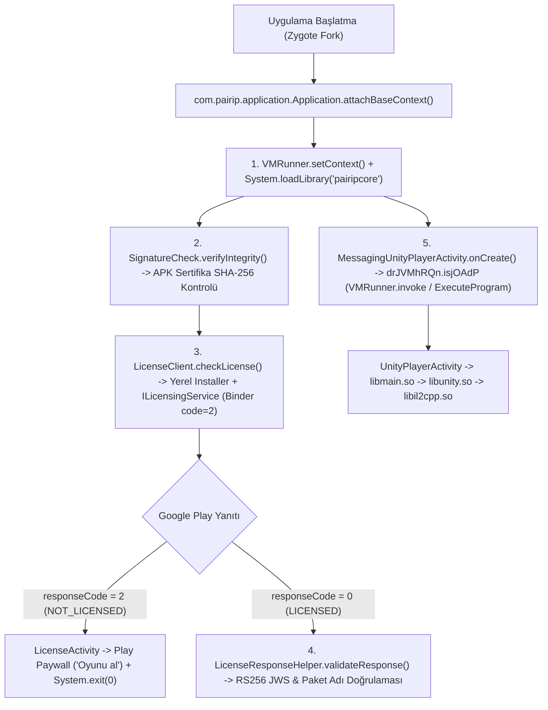
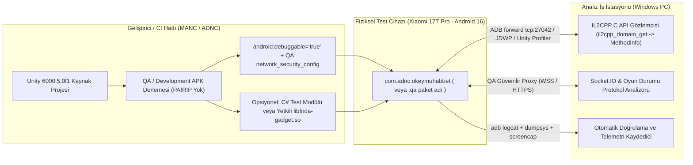

# Okey Muhabbet (`com.adnc.okeymuhabbet` v3.1.33) — PAIRIP ve Çalışma Zamanı Kod Enjeksiyonu Uyumluluk Analizi

**Tarih:** 17.11.2026  
**Hedef Uygulama:** `com.adnc.okeymuhabbet` (`v3.1.33`, `versionCode: 118`, Unity `6000.5.0f1` IL2CPP `arm64-v8a`)  
**Fiziksel Test Cihazı:** Xiaomi 17T Pro (`2602EPTC0G` / `warhol_global`, Android 16 / SDK 36, `OS3.0.311.0.WPSMIXM`)  
**Referans Ön Rapor:** [okey_muhabbet_analiz_raporu.md](file:///e:/apk/test-okey/okey_muhabbet_analiz_raporu.md)

> [!IMPORTANT]
> **Yönetici Özeti:**  
> `com.adnc.okeymuhabbet` üretim paketi, Google Play Console'un **Automatic Integrity Protection (`com.pairip` + `libpairipcore.so`)** katmanı ile sarılmış durumdadır. Yapılan statik tersine mühendislik (`rea` JADX + Ghidra + ELF/IL2CPP analizleri) ve fiziksel Xiaomi 17T Pro testleri iki temel gerçeği kesin olarak kanıtlamıştır:
> 1. **Google Play'den resmi kurulum (Senaryo A)** yalnızca uygulamanın açılmasını sağlar; kilitli/root'suz fiziksel cihazda (`ro.debuggable=0`, `SELinux=Enforcing`, `android:debuggable=false`) **harici Frida enjeksiyonu işletim sistemi çekirdeği tarafından engellenir** (`Connection closed` / `package not debuggable`), APK içine **Frida Gadget gömülmesi** ise APK v2/v3 imzasını bozduğu için hem `SignatureCheck` hem `libpairipcore.so` VM katmanı hem de Google Play `ILicensingService` tarafından reddedilir.
> 2. **Sürdürülebilir ve meşru çalışma zamanı analiz ortamı**, koruma katmanını yama/bypass etmeye çalışmakla değil; geliştiricinin (`MANC` / `ADNC`) Google Play PAIRIP sarmalayıcısından geçmemiş **doğrudan Unity QA / Development derlemesi (Senaryo C veya D)** sağlamasıyla mümkündür. Üstelik `libil2cpp.so` içinde **2.419 dinamik sembolün ve tüm standart `il2cpp_*` çalışma zamanı C API fonksiyonlarının kırpılmamış (unstripped) olduğu** kanıtlanmıştır; bu sayede yetkili QA derlemesinde Unity 6 `global-metadata.dat` sürüm `106` farklılığına takılmadan doğrudan çalışma zamanı C API gözlemi yapılabilir.

---

## 1. Teknik Gerçekler

Mimari değerlendirmeye temel oluşturan ve doğrudan ikili paket + fiziksel cihaz üzerinden ölçülen değişmez teknik gerçekler şunlardır:

### 1.1 Uygulama ve Paket Mimarisi
- **Paket Kimliği:** `com.adnc.okeymuhabbet`, `versionName: 3.1.33`, `versionCode: 118`, `minSdk: 26`, `targetSdk: 36`.
- **Oyun Motoru ve Çalışma Zamanı:** Unity 6 (`6000.5.0f1`, `88b47c5e7076`, `Release`), Scripting Backend: **`il2cpp`**, Mimari: yalnızca **`arm64-v8a`**.
- **Split APK Yapısı:**
  - `com.adnc.okeymuhabbet.apk` (`80.820.097` bayt, SHA-256: `be115bf282d1b63804cade90e35a038994e99d4ae27602fc6d047658d084c23c`): Manifest, DEX (`classes2.dex`), PAIRIP VM bayt kodları ve Unity varlıkları (`global-metadata.dat` dahil).
  - `config.arm64_v8a.apk` (`39.085.209` bayt, SHA-256: `564564bba8b48cf0ec101f2f76751b37759bbdc106cd80c09d49492a9b8dfed3`): `libil2cpp.so` (`65,45 MB`), `libunity.so` (`30,24 MB`), `libpairipcore.so` (`609 KB`), `libvivox-sdk.so` (`12,83 MB`), `libFirebaseCppApp-12_10_1.so` (`4,27 MB`).
- **Kriptografik İmza Yapısı:** Her iki APK da **APK Signature Scheme v2 + v3** (`Sertifika SHA-256: 1e9f627e3835f6b56add77c5ea5e5bbb5eb1be6a5e1c2e284bbc8ef5155cc0e5`) ve **Google Play Source Stamp** (`3257d599a49d2c961a471ca9843f59d341a405884583fc087df4237b733bbd6d`) taşımaktadır; v1 (JAR) imzası yoktur.

### 1.2 Fiziksel Cihaz Güvenlik Sınırları (Xiaomi 17T Pro)
- **Donanım / Üretim Derlemesi:** Xiaomi `2602EPTC0G` (`warhol_global`), Android 16 (SDK 36), `user/release-keys` (`BP2A.250605.031.A3` / `OS3.0.311.0.WPSMIXM`).
- **Çekirdek ve Erişim Kısıtları:**
  - `SELinux`: **`Enforcing`**
  - `ro.debuggable`: **`0`**
  - `ro.secure`: **`1`**
  - Root / `su` ikilisi: **Yok (`NO_SU_BINARY`)**
  - CPU ABI Desteği: **Yalnızca `arm64-v8a`** (32-bit `armeabi-v7a` donanımsal/işletim sistemi düzeyinde kapalıdır).

### 1.3 Uygulamadaki 5 Katmanlı PAIRIP Koruma Zinciri



---

## 2. Doğrulanmış Bulgular

Aşağıdaki tüm bulgular bizzat `rea` MCP araçları, Normal Ghidra (`12.1.4`) headless analizi ve bağlı Xiaomi 17T Pro cihazındaki güvenli gözlem komutlarıyla doğrulanmıştır:

| # | İncelenen Bileşen / Test | Doğrulanmış Teknik Bulgu | Kanıt / Kaynak |
|---|---|---|---|
| 1 | `AndroidManifest.xml` | Uygulama giriş sınıfı `com.pairip.application.Application` olarak değiştirilmiştir; `android:debuggable` **tanımsızdır (`false`)**; `android:networkSecurityConfig` **tanımsızdır** (`targetSdk=36` varsayılanı: kullanıcı CA sertifikaları reddedilir). | `ev_dee606b2b663c1d4...` |
| 2 | `Application.attachBaseContext` | `super.attachBaseContext` öncesinde sırasıyla `VMRunner.setContext(context)`, `SignatureCheck.verifyIntegrity(context)` ve `LicenseClient.checkLicense(context)` çağrılır. | `ev_e695af91d541394d...` |
| 3 | `SignatureCheck.verifyIntegrity` | Çalışma zamanında `PackageManager.getPackageInfo(..., 64).signatures[0]` özeti `SHA-256` Base64 olarak hesaplanır; `expectedSignature`, `expectedTestSignature` veya `ALLOWLISTED_SIG` ile eşleşmezse `SignatureTamperedException("Apk signature is invalid.")` fırlatılır. | `ev_ef364983710f3c3b...` |
| 4 | `LicenseClient.initializeLicenseCheck` | Yerel kurulum kaynağı `com.android.vending` olsa bile (`LOCAL_CHECK_OK`), `lambda$initializeLicenseCheck$1` üzerinden çevrimiçi `ILicensingService` (`TRANSACTION_CHECK_LICENSE_V2`) bağlantısı zorunlu olarak başlatılır. | `ev_6f00c939f6aa0653...`, `ev_9938fc265a6aa03d...` |
| 5 | `LicenseResponseHelper` | `ILicensingService` yanıtındaki `LICENSE_DATA` alanı JWS olarak ayrıştırılır; `alg == "RS256"` şartı, gömülü RSA açık anahtarıyla `SHA256withRSA` imza doğrulaması ve `packageName == "com.adnc.okeymuhabbet"` kontrolü yapılır. | `ev_8fcf2a2e48fe40d8...`, `ev_0ff99cdb620250bb...`, `ev_df7dffbe5665eb0f...` |
| 6 | `VMRunner` & `drJVMhRQn` | `MessagingUnityPlayerActivity.onCreate()` doğrudan Unity'yi çağırmak yerine `com.google.gson.reflect.rnf.drJVMhRQn.isjOAdP.invoke(...)` çağrısı yapar; bu `Method` referansı yalnızca `libpairipcore.so` VM bayt kodu çalıştığında doldurulur ve `VMRunner.openBaseApk()` diskteki `base.apk` dosyasını doğrudan ZIP olarak açar. | `ev_18b6da84d2bfd17f...`, `ev_c73237e5efbcb07e...`, `ev_4f222ab2e4c97846...` |
| 7 | `libpairipcore.so` (`609.416` bayt) | Yalnızca 3 sembol dışa aktarır: `JNI_OnLoad @ 0x89b04`, `ExecuteProgram @ 0x6a778`, `JNI_OnUnload @ 0x8b358`. Ghidra decompile çıktısında `JNI_OnLoad` içinde `getpid()` kaydı ve yığın üzerinde bayt-bayt dizge gizleme (`"android/content/Context"`), `ExecuteProgram` içinde ise ilklendirme bütünlük bayrakları (`DAT_00198e5a == 1`) doğrulanmıştır. | `ev_b452636813700293...`, Ghidra `00189b04` / `0016a778` |
| 8 | Fiziksel Cihaz `run-as` ve Harici Frida | Xiaomi 17T Pro üzerinde `run-as com.adnc.okeymuhabbet` komutu `run-as: package not debuggable` hatası vermiş; `list_frida_processes` çağrısı USB üzerinden `Connection closed` ile reddedilmiştir. | Cihaz ADB testi + `rea` `list_frida_processes` |
| 9 | Google Play Mağaza Tespiti | Cihazda Google Play `"Oyunu al"` akışı tetiklendiğinde Play Store, yüklü paketin mağaza dışı olduğunu tespit edip *"Cihazınızda yüklü uygulama, Google Play'den gelmemiş olup Play'deki güncellemeleri almayacaktır."* uyarısını ve `Play'den güncelle` seçeneğini göstermiştir. | `ev_4e7177077ee7b718...` |
| 10 | `global-metadata.dat` (`10.128.084` bayt) | Dosya **şifrelenmemiştir** (`magic = 0xFAB11BAF`), ancak Unity `6000.5.0f1` ile gelen **IL2CPP Metadata Sürüm `106`** biçimindedir. İçinde `socket.io`, `.Okey.53.`, `com.mancgames.shared`, `unity.services.authentication` düz metin tanımlayıcıları yer alır; v24–v39 bekleyen statik araçlar sürüm `106` nedeniyle hata verir. | `ev_93e26a2555222ab0...`, Başlık ikili analizi |
| 11 | `libil2cpp.so` (`65.456.416` bayt) | Toplam **2.419 adet global/weak dinamik sembol** kırpılmadan dışa aktarılmıştır; `il2cpp_init` (`0x187b45c`), `il2cpp_domain_get` (`0x187ba68`), `il2cpp_domain_get_assemblies` (`0x187ba74`), `il2cpp_class_from_name` (`0x187b5bc`), `il2cpp_class_get_methods` (`0x187b5e0`), `il2cpp_method_get_name` (`0x187bdb0`), `il2cpp_runtime_invoke` (`0x187be98`) ve `il2cpp_string_new` (`0x187beb4`) tam olarak mevcuttur. | `ev_1f67be1efd149bf0...`, `ev_eacd6160cc6b1da8...` |

---

## 3. Henüz Doğrulanmamış Varsayımlar

Kanıt disiplini gereği, statik paket analizi ve mevcut sideload/Play Store arayüz gözlemleriyle henüz doğrudan test edilmemiş noktalar şunlardır:

1. **Oyun Sunucusu (`socket.io` / Backend) Play Integrity Attestation Kontrolü:** Uygulama açıldıktan sonra oyun sunucusuna bağlanırken Google Play Integrity API (`IntegrityTokenResponse`) jetonu talep edilip edilmediği, yalnızca tam çalışan bir oturum açma ve masa bağlantısı sırasında doğrulanabilir.
2. **Periyodik Lisans Kontrolü (`repeatedCheckEnabled`) Bayrak Değeri:** `LicenseClient` içindeki `repeatedCheckEnabled` ve `localCheckEnabled` statik alanları `libpairipcore.so` VM bayt kodu tarafından çalışma zamanında atandığından, uzun süreli (30+ dakika) oturumlarda tekrarlı lisans sorgusu sıklığı çalışma zamanı gözlemi gerektirir.
3. **Uygulama İçi Özel Obfuscation / Anti-Cheat Varlığı:** `global-metadata.dat` içindeki C# sınıf/metot adlarının BeeByte/Obfuscator ile karıştırılıp karıştırılmadığı, metadata sürüm `106` uyumlu bir ayrıştırıcı veya yetkili QA derlemesinde `il2cpp_class_get_methods` dökümü çalıştırıldığında kesinleşecektir.
4. **Geliştirici Ekibin (`MANC` / `ADNC`) Derleme Teslim Süreci:** Geliştirici ekipten doğrudan Unity `Development Build` veya PAIRIP içermeyen imzalı QA APK alınabilme süresi organizasyonel erişime bağlıdır.

---

## 4. Senaryo Bazında Bağımsız Uygulanabilirlik Analizi

### Senaryo A — Google Play Üzerinden Yüklenmiş, Değiştirilmemiş Uygulama
- **PAIRIP Kontrolünün Etkisi:** `installerPackageName = com.android.vending` olarak kaydedilir ve cihazdaki Google hesabına Play lisans kaydı (`LICENSED = 0`) tanımlanır. `SignatureCheck`, `LicenseClient` ve `LicenseResponseHelper` (`RS256` JWS) kontrolleri meşru olarak geçilir; uygulama kapanmadan normal açılır.
- **APK Bütünlüğü ve İmza Gereksinimleri:** Orijinal Google Play v2/v3 imzası (`1e9f627e...`) ve `base.apk` bütünlüğü %100 korunur; hiçbir dosya değişikliği yapılamaz.
- **Unity IL2CPP Uyumluluğu:** `libil2cpp.so` normal çalışır ancak süreç `untrusted_app` SELinux bağlamında ve `android:debuggable="false"` olarak izole edilir; dışarıdan süreç belleğine erişilemez.
- **Kullanılabilecek Analiz Yöntemleri:**
  - Görsel/fonksiyonel oyun kuralları ve UI akış testi,
  - ADB `uiautomator dump`, ekran görüntüsü (`screencap`) ve video kaydı,
  - ADB `logcat` üzerinden Unity'nin açık bıraktığı `Debug.Log` / `Vivox` / `Firebase` çıktıları.
- **Teknik Olarak Mümkün Olmayan Yöntemler (`MÜMKÜN DEĞİL`):**
  - ❌ Root'suz Xiaomi 17T Pro üzerinde harici Frida (`frida -U`) ile sürece bağlanma (`ptrace` ve `frida-server` yokluğu nedeniyle imkânsız),
  - ❌ `run-as com.adnc.okeymuhabbet` ile uygulama veri dizinine (`/data/data/com.adnc.okeymuhabbet`) erişim,
  - ❌ Kendi yazdığımız C#/JS/C++ analiz kodunu uygulama sürecinin içine enjekte etme,
  - ❌ Kullanıcı CA sertifikası yükleyerek HTTPS/WSS (`socket.io`) trafiğini şifresiz çözme (`targetSdk=36` ve `networkSecurityConfig` yokluğu nedeniyle).

---

### Senaryo B — Değiştirilmemiş Uygulama Üzerinde Harici Gözlem ve Log Analizi
- **PAIRIP Kontrolünün Etkisi:** Uygulama Google Play'den kurulduğu sürece PAIRIP hiçbir engel çıkarmaz; çünkü APK baytlarına, imzasına veya süreç belleğine müdahale edilmemektedir.
- **APK Bütünlüğü ve İmza Gereksinimleri:** Tamamen değiştirilmemiş üretim paketi kullanılır; ek olarak PC üzerinde APK kopyası üzerinde çevrimdışı (offline) statik analiz yürütülür.
- **Unity IL2CPP Uyumluluğu:** Statik olarak `libil2cpp.so` Ghidra ile incelenebilir ve `global-metadata.dat` (v106) içindeki string/sınıf tabloları özel v106 okuyucu ile çıkarılabilir; ancak çalışma zamanında C# metot argümanları kancalanamaz (hooklanamaz).
- **Kullanılabilecek Analiz Yöntemleri:**
  - `adb logcat` (`Unity`, `Firebase`, `Vivox`, `ActivityTaskManager`, `InputDispatcher`),
  - `adb shell dumpsys` (`meminfo`, `gfxinfo framestats`, `netstats`, `activity`),
  - Wi-Fi Access Point / Router üzerinden pasif PCAP (`tshark`/`Wireshark`) yakalama: DNS sorguları, sunucu IP/port envanteri, TLS SNI başlıkları, paket boyutları ve zamanlama analizi,
  - Çevrimdışı statik analiz (`rea` MCP, Ghidra, Unity AssetBundle incelemesi).
- **Teknik Olarak Mümkün Olmayan Yöntemler (`MÜMKÜN DEĞİL`):**
  - ❌ Bellek içi (in-memory) oyun durumu okuma veya değiştirme,
  - ❌ Şifreli TLS / WSS (`socket.io`) uygulama katmanı JSON yüklerini düz metin olarak okuma,
  - ❌ Özel test/otomasyon kodunu Unity C# `MonoBehaviour` veya IL2CPP çalışma zamanı içinde koşturma.

---

### Senaryo C — Yetkili Geliştirici/Test Derlemesi Üzerinde Frida Gadget Gibi Çalışma Zamanı Analiz Araçları
- **PAIRIP Kontrolünün Etkisi:**
  - **Kritik Ayrım:** PAIRIP (`com.pairip.*` + `libpairipcore.so`), Unity'nin kendi derleme çıktısında **yoktur**; Google Play Console'a yüklenen AAB paketinden mağaza APK'ları üretilirken Google tarafından enjekte edilir.
  - Eğer geliştirici, Play Console mağaza APK'sı yerine **doğrudan kendi CI/Gradle hattından üretilmiş yetkili test APK'sını** (PAIRIP sarmalayıcısı olmadan) verir veya `libfrida-gadget.so` kütüphanesini kendi derleme/imzalama hattında pakete dahil ederse PAIRIP engeli **tamamen ortadan kalkar**.
  - Tersine, Play Store'dan alınmış PAIRIP'li bir APK sonradan açılıp içine `frida-gadget` eklenirse bu işlem **yetkisiz yeniden paketleme** sayılır ve PAIRIP'in imza + native VM kontrollerine takılarak **başarısız olur**.
- **APK Bütünlüğü ve İmza Gereksinimleri:** Geliştirici veya yetkili QA derleme hattı; `lib/arm64-v8a/libfrida-gadget.so` (ve isteğe bağlı `libfrida-gadget.config.so`) dosyasını derleme sırasında pakete ekler, `INTERNET` izni zaten mevcuttur ve APK tek seferde geliştiricinin test/QA anahtarıyla (`zipalign` + `apksigner` v2/v3) temiz biçimde imzalanır.
- **Unity IL2CPP Uyumluluğu:** **YÜKSEK UYUMLULUK.** Root gerektirmeden Xiaomi 17T Pro (`ro.debuggable=0`) üzerinde `frida -U -f com.adnc.okeymuhabbet` veya `adb forward tcp:27042 tcp:27042` üzerinden doğrudan `libil2cpp.so` içindeki 2.419 dışa aktarılmış sembole (`il2cpp_domain_get`, `il2cpp_class_get_methods`, `il2cpp_runtime_invoke` vb.) erişilir.
- **Kullanılabilecek Analiz Yöntemleri:**
  - Frida Gadget (`Listen` / `Script` modu) ile tüm `il2cpp_*` C API fonksiyonlarını kullanarak çalışma zamanında C# sınıf/metot keşfi ve `Interceptor.attach` ile metot giriş/çıkış parametrelerinin izlenmesi,
  - `socket.io` / ağ istemci sınıflarının TLS şifrelemesi öncesinde/sonrasında uygulama katmanında düz metin olarak gözlemlenmesi,
  - Kendi geliştirdiğimiz JS/TypeScript tabanlı çalışma zamanı test ajanlarının (`frida-compile`) uygulama ile birlikte koşması.
- **Teknik Olarak Mümkün Olmayan Yöntemler (`MÜMKÜN DEĞİL`):**
  - ❌ Play Console'dan indirilmiş PAIRIP korumalı üretim APK'sına imza/koruma kırmadan dışarıdan Gadget enjekte etmek,
  - ❌ `android:debuggable="false"` bırakılmış bir QA derlemesinde işletim sistemi seviyesinde `jdwp` / C# adım adım (step-by-step) debugger bağlamak (bunun için Senaryo D gerekir).

---

### Senaryo D — Uygulama Geliştiricisinin Sağladığı Debug veya QA Sürümü (`Development Build`)
- **PAIRIP Kontrolünün Etkisi:** **Sıfır etki (PAIRIP bulunmaz).** Unity Editor veya CI üzerinden `Development Build` işaretlenerek üretilen doğrudan APK derlemelerinde `com.pairip.*` sınıfları ve `libpairipcore.so` yer almaz; `MessagingUnityPlayerActivity.onCreate` doğrudan `UnityPlayerActivity.onCreate` akışını çalıştırır.
- **APK Bütünlüğü ve İmza Gereksinimleri:** Geliştirici QA/Debug keystore ile imzalanır; `AndroidManifest.xml` içinde `android:debuggable="true"` ve test ortamı için `android:networkSecurityConfig="@xml/network_security_config"` (`<certificates src="user"/>` yalnızca debug/QA varyantında) meşru olarak tanımlanır.
- **Unity IL2CPP Uyumluluğu:** **MAKSİMUM (TAM) UYUMLULUK.** Hem Unity'nin yerleşik profilleyici/hata ayıklayıcı altyapısı (`Script Debugging`, `Autoconnect Profiler`, IL2CPP sembol dosyaları `libil2cpp.sym.so`) hem C# test kancaları hem de istenirse Frida/LLDB (`run-as` açık olduğu için) sorunsuz çalışır.
- **Kullanılabilecek Analiz Yöntemleri:**
  - Unity Profiler, Frame Debugger, Memory Profiler ve C# `Script Debugging` (IDE üzerinden breakpoint),
  - Uygulama içine doğrudan C# `RuntimeInitializeOnLoadMethod` ile kendi test/analiz modüllerimizi derleme veya yükleme,
  - `run-as com.adnc.okeymuhabbet` ile `/data/data/com.adnc.okeymuhabbet` altındaki `PlayerPrefs`, önbellek ve SQLite dosyalarını doğrudan inceleme,
  - Debug `networkSecurityConfig` sayesinde harici vekil sunucu ile HTTPS / `socket.io` WSS trafiğini tam şifresiz inceleme,
  - Harici/dahili Frida veya LLDB ile native `libil2cpp.so` sembollü (`libil2cpp.sym.so`) analiz.
- **Teknik Olarak Mümkün Olmayan Yöntemler:**
  - ❌ Yalnızca Google Play üretim (Production) sunucusunun `Play Integrity` üretim sertifikası (`1e9f627e...`) şartı koştuğu uç noktalar varsa, bu uç noktaların QA sunucusu veya geliştirici allowlist'i olmadan çağrılması (geliştirici Play Console'da QA imzasını/hesabını yetkilendirerek çözer).

---

### Senaryo Karşılaştırma Özeti

| Değerlendirme Kriteri | Senaryo A (Play Store Üretim) | Senaryo B (Harici Gözlem) | Senaryo C (Yetkili Derleme + Gadget) | Senaryo D (Geliştirici Debug/QA) |
|---|---|---|---|---|
| **PAIRIP Engeli** | Geçer (Meşru Lisans) | Geçer (Müdahalesiz) | Yok (Play Dışı Derleme) | Yok (Play Dışı Derleme) |
| **Xiaomi 17T Pro (Root'suz) Çalışma** | ✅ Çalışır | ✅ Çalışır | ✅ Çalışır | ✅ Çalışır |
| **Kendi Analiz Kodumuzu Koşturma** | ❌ Mümkün Değil | ❌ Mümkün Değil | ✅ Mümkün (Frida JS/CModule) | ✅ Mümkün (C# + Native + Profiler) |
| **IL2CPP Metot/Veri Gözlemi** | ❌ Mümkün Değil | ⚠️ Yalnızca Statik | ✅ Tam (`il2cpp_*` C API) | ✅ Tam (Sembollü + Debugger) |
| **Ağ (`socket.io`) Düz Metin Analizi** | ❌ Mümkün Değil | ⚠️ Yalnızca Meta Veri | ✅ Mümkün (Bellek içi Hook) | ✅ Mümkün (Proxy + Hook) |
| **Sürdürülebilirlik** | Düşük (Salt Görsel) | Orta (Kısıtlı Telemetri) | Yüksek | **En Yüksek (Önerilen)** |

---

## 5. Kritik Soruların Kanıtlı Yanıtları

### Soru 1: Google Play'den kurulan değiştirilmemiş uygulamada harici Frida tabanlı gözlem yapılabilir mi?
**Hayır — mevcut Xiaomi 17T Pro test ortamında teknik olarak mümkün değildir.**  
Bunun nedeni PAIRIP değil, doğrudan Android 16 / Linux çekirdek güvenlik modelidir:
- Cihaz üretim (`user/release-keys`) derlemesidir (`ro.debuggable=0`, `SELinux=Enforcing`, `NO_SU_BINARY`).
- Uygulama manifestinde `android:debuggable="false"` durumdadır (`run-as com.adnc.okeymuhabbet` -> `package not debuggable`).
- Cihazda root yetkisiyle çalışan `frida-server` bulunmadığı için `rea` `list_frida_processes` testi doğrudan `Connection closed` döndürmüştür. Root olmayan bir cihazda dışarıdan çalışan hiçbir süreç, `android:debuggable="false"` olan başka bir uygulamanın adres uzayına `ptrace` yapamaz veya `.so` enjekte edemez.

### Soru 2: Frida Gadget kullanmak için APK değişikliği gerekiyorsa bu durum PAIRIP açısından ne anlama gelir?
Üretim APK'sına dışarıdan `libfrida-gadget.so` eklemek için DEX/Manifest veya ELF (`libmain.so` `DT_NEEDED`) değişikliği yapıp APK'yı yeniden imzalamak gerekir. Bu işlem PAIRIP korumalı pakette **üç ayrı bütünlük duvarına çarpar**:
1. **Java İmza Kontrolü (`SignatureCheck.verifyIntegrity`):** Yeni imzanın SHA-256 özeti `expectedSignature` ile eşleşmediği anda `attachBaseContext` içinde `SignatureTamperedException("Apk signature is invalid.")` fırlatılır (`ev_ef364983710f3c3b...`).
2. **Native VM ve Base APK Kontrolü (`libpairipcore.so` + `VMRunner.openBaseApk`):** `MessagingUnityPlayerActivity.onCreate()` metodunun çalışması için gereken `drJVMhRQn.isjOAdP` yansıma hedefi `libpairipcore.so` tarafından çözülür (`ev_18b6da84d2bfd17f...`). APK değiştirildiğinde native VM bütünlük kontrolü başarısız olur ve Unity aktivitesi başlatılamaz.
3. **Google Play `ILicensingService` Sertifika Uyuşmazlığı:** Play Store servisi paket adı ile imzalayan sertifikayı birlikte doğrular; yeniden imzalanmış APK geçerli Play lisansı alamaz.

Dolayısıyla Frida Gadget **yalnızca geliştirici tarafından PAIRIP sarmalayıcısı olmadan üretilmiş yetkili test/QA derlemesinde (Senaryo C/D)** meşru ve sorunsuz olarak kullanılabilir.

### Soru 3: Unity IL2CPP uygulamasında native seviyede gözlem nasıl yapılabilir?
Yapılan statik analiz çok önemli bir teknik detayı ortaya çıkarmıştır:
- **Statik Metadata Sürüm Farkı:** `global-metadata.dat` şifresizdir (`0xFAB11BAF`), ancak Unity `6000.5.0f1` **Metadata Sürüm `106`** kullanmaktadır (`ev_93e26a2555222ab0...`). Klasik `Il2CppDumper` veya v24–v39 bekleyen statik ayrıştırıcılar bu dosyayı doğrudan okuyamaz.
- **Çalışma Zamanı C API Çözümü (Doğrulandı):** `libil2cpp.so` üzerinde yapılan `inspect_native_exports` (`ev_eacd6160cc6b1da8...`) analizinde tüm standart IL2CPP içebakış (introspection) fonksiyonlarının **açık ve kırpılmamış** olduğu kanıtlanmıştır:

| Dışa Aktarılan Sembol (`libil2cpp.so`) | RVA Adresi | Görevi |
|---|---|---|
| `il2cpp_init` | `0x187b45c` | IL2CPP çalışma zamanı ilklendirme noktası |
| `il2cpp_domain_get` | `0x187ba68` | Aktif `Il2CppDomain*` işaretçisini döndürür |
| `il2cpp_domain_get_assemblies` | `0x187ba74` | Yüklü tüm C# assembly listesini döndürür |
| `il2cpp_class_from_name` | `0x187b5bc` | Ad alanı ve sınıf adından `Il2CppClass*` bulur |
| `il2cpp_class_get_methods` | `0x187b5e0` | Sınıftaki tüm metotların `MethodInfo*` ve native kod işaretçilerini sıralar |
| `il2cpp_method_get_name` | `0x187bdb0` | `MethodInfo*` üzerinden C# metot adını döndürür |
| `il2cpp_runtime_invoke` | `0x187be98` | Herhangi bir C# metodunu çalışma zamanında çağırır |
| `il2cpp_string_new` | `0x187beb4` | Native katmandan yönetilen `System.String` üretir |

Yetkili QA/Debug derlemesinde analiz kodu, `global-metadata.dat` dosyasını kendisi ayrıştırmak yerine doğrudan `libil2cpp.so`'nun kendi yerleşik v106 okuyucusunu kullanan bu C API fonksiyonlarını çağırır; elde edilen `MethodInfo->methodPointer` adreslerine native kanca (`Interceptor.attach`) yerleştirerek oyun mekaniklerini %100 doğrulukla gözlemler.

### Soru 4: PAIRIP kontrolü başarılı olsa bile sonradan yapılan değişiklikler hangi bütünlük kontrollerine takılabilir?
1. **Periyodik Lisans Yenileme (`RepeatedCheckMetadata`):** `LicenseClient.scheduleRepeatedLicenseCheck` (`REPEATED_CHECK_RETRY_DELAY_MILLIS = 300.000 ms`) oturum devam ederken lisansı yeniden doğrulayabilir (`ev_aee43058d75ce7d5...`).
2. **Android Paket Doğrulama ve APK Signature v3:** Yüklü `/data/app/.../base.apk` veya split APK'lar üzerinde herhangi bir bayt değişikliği paket imzasını geçersiz kılar.
3. **PAIRIP Çalışma Zamanı VM Çağrıları (`VMRunner.invoke`):** Yalnızca açılışta değil, korunan aktivite/yaşam döngüsü geçişlerinde `openBaseApk()` üzerinden `base.apk` tekrar okunabilir (`ev_4f222ab2e4c97846...`).
4. **Android 16 (`targetSdk=36`) Ağ Güvenliği Politikası:** `networkSecurityConfig` bulunmadığı için sonradan cihaza kullanıcı CA sertifikası eklenmesi TLS doğrulamasını geçemez; bağlantı TLS el sıkışmasında kopar (`ev_dee606b2b663c1d4...`).
5. **Sunucu Tarafı Oturum ve Kimlik Doğrulama:** `global-metadata.dat` içinde tespit edilen `unity.services.authentication` ve `socket.io` katmanları istemci sürümü ve oturum jetonlarını sunucu tarafında denetler.

### Soru 5: Geliştirici tarafından sağlanan yetkili QA sürümü bu sorunu nasıl çözer?
- PAIRIP, oyun kodunun bir parçası değil **Google Play mağaza dağıtım sarmalayıcısıdır**. Geliştirici (`MANC` / `ADNC`) Unity `6000.5.0f1` projesinden doğrudan **QA / Development APK** ürettiğinde pakette `com.pairip.*` ve `libpairipcore.so` bulunmaz.
- Geliştirici derleme ayarlarında meşru olarak şu üç bileşeni etkinleştirebilir:
  1. `Development Build` + `android:debuggable="true"` (cihazı root'lamadan `run-as`, profilleyici ve debugger erişimi açılır),
  2. QA varyantına özel `network_security_config.xml` (güvenli test proxy gözlemi açılır),
  3. İsteğe bağlı derleme içi test telemetri modülü (C# `Assembly-CSharp` / Unity paket eklentisi) veya QA imzalı `libfrida-gadget.so`.
- Böylece hiçbir güvenlik mekanizması kırılmadan, Xiaomi 17T Pro üzerinde tamamen yasal, tekrarlanabilir ve sürüm güncellemelerine dayanıklı bir test ortamı elde edilir.

### Soru 6: Orijinal uygulamanın dosyalarına müdahale etmeden oyun davranışlarını analiz edebilmek için hangi yöntemler kullanılabilir?
1. **Google Play Resmi Kurulum + ADB `logcat` Akış Analizi:** Değiştirilmemiş Play kurulumu çalıştırılıp `adb logcat -v threadtime` ile Unity, VisualScripting, Firebase ve Vivox durum geçişleri izlenir.
2. **UI Otomasyonu ve Görsel Durum Çıkarımı (`uiautomator` + Ekran Yakalama):** Oyun ekranları ve hamle süreleri ADB üzerinden müdahalesiz kaydedilip analiz edilir.
3. **Sistem Telemetrisi (`dumpsys`):** `dumpsys gfxinfo com.adnc.okeymuhabbet framestats`, `dumpsys meminfo` ve `dumpsys netstats` ile kare süreleri, bellek tahsisi ve soket veri hacmi ölçülür.
4. **Ağ Geçidi (Wi-Fi AP) Düzeyinde Pasif PCAP Analizi:** Cihaz trafiği test Wi-Fi noktası üzerinden geçirilerek `Wireshark`/`tshark` ile bağlanılan `socket.io` ve `Vivox` sunucu uç noktaları, paket frekansları ve gecikme profilleri çıkarılır.
5. **Çevrimdışı Statik Kod ve Varlık Analizi:** Cihaz dışındaki kopya üzerinde `libil2cpp.so` (Ghidra + C API haritalama), `global-metadata.dat` (v106 string/tip indeksleme) ve Unity AssetBundle dosyaları orijinal cihaza dokunmadan incelenir.

---

## 6. Frida / Gadget / Unity IL2CPP Uyumluluk Matrisi

| Bileşen / Araç | Üretim APK (Sideload) | Üretim APK (Google Play) | Yetkili QA APK + Gadget (Senaryo C) | Geliştirici Debug/QA APK (Senaryo D) | Teknik Açıklama |
|---|---|---|---|---|---|
| `frida -U` (Harici USB, Root'suz) | ❌ Uyumsuz | ❌ Uyumsuz | ✅ Uyumlu (Gadget Üzerinden) | ✅ Uyumlu (`debuggable` / Gadget) | `ro.debuggable=0` cihazda `frida-server` olmadan dıştan attach yapılamaz (`Connection closed`). |
| `libfrida-gadget.so` (Sonradan Repack) | ❌ Uyumsuz | ❌ Uyumsuz | ➖ Gerekmez | ➖ Gerekmez | Sonradan repack işlemi `SignatureCheck` ve `libpairipcore.so` bütünlüğünü bozar. |
| `libfrida-gadget.so` (Geliştirici Derlemesi) | ➖ Uygulanamaz | ➖ Uygulanamaz | ✅ Tam Uyumlu | ✅ Tam Uyumlu | PAIRIP bulunmayan QA derlemesinde geliştirici imzasıyla doğrudan çalışır. |
| Klasik `Il2CppDumper` (v24–v39) | ❌ Uyumsuz | ❌ Uyumsuz | ❌ Uyumsuz | ❌ Uyumsuz | Unity `6000.5.0f1` `global-metadata.dat` **sürüm `106`** kullanır (`ev_93e26a2555222ab0...`). |
| Özel `il2cpp_*` Runtime C API Köprüsü | ❌ Süreç Kapalı | ❌ Enjeksiyon Yok | ✅ Tam Uyumlu | ✅ Tam Uyumlu | `libil2cpp.so` içindeki 2.419 sembol (`0x187b45c` vb.) v106 yapısını yerleşik çözer. |
| C# Özel Test Modülü / Unity Profiler | ❌ Uyumsuz | ❌ Uyumsuz | ⚠️ Yalnızca Native/JS | ✅ Tam Uyumlu | Doğrudan C# kodu koşturmak için geliştirici QA/Debug derlemesi idealdir. |

---

## 7. Önerilen Sürdürülebilir Çalışma Mimarisi

Oyun mekaniklerini analiz etmek ve kendi geliştirdiğimiz analiz/test kodlarını sürdürülebilir biçimde çalıştırmak için önerilen **İki Hatlı Yetkili Test Mimarisi** aşağıdadır:



### Mimari İlkeler
1. **Birincil Hat (Tam Kod Çalıştırma ve IL2CPP Analizi — Senaryo D / C):** Geliştiriciden `com.adnc.okeymuhabbet` (veya üretimle çakışmaması için `com.adnc.okeymuhabbet.qa` `applicationIdSuffix` ile) **Google Play sarmalayıcısız doğrudan Unity QA/Development APK** talep edilir. Kendi analiz kodumuz ya doğrudan Unity C# test paketi (`RuntimeInitializeOnLoadMethod`) olarak derlemeye eklenir ya da geliştiricinin derlemeye dahil ettiği `libfrida-gadget.so` üzerinden `il2cpp_*` C API sembollerini (`ev_eacd6160cc6b1da8...`) çağırarak çalışır.
2. **İkincil Hat (Üretim Karşılaştırma ve Regresyon — Senaryo A + B):** Uygulama Google Play Store üzerinden resmi olarak kurulur; hiçbir dosya/bellek müdahalesi yapmadan `logcat`, `dumpsys` ve pasif ağ gözlemiyle QA sürümü ile üretim sürümü arasındaki performans/davranış farkları doğrulanır.

---

## 8. Fiziksel Xiaomi 17T Pro Cihazında Doğrulama Planı

### Faz 1 — Mevcut Üretim Ortamında Hemen Uygulanabilir Müdahalesiz Gözlem (Doğrulandı / Hazır)
1. Cihazda Google Play Store üzerinden resmi kurulum/güncelleme tamamlanır (`installerPackageName = com.android.vending`).
2. Temiz log tamponu ile uygulama başlatılır ve 60+ saniye kararlılık doğrulanır:
   ```powershell
   adb logcat -c
   adb shell monkey -p com.adnc.okeymuhabbet -c android.intent.category.LAUNCHER 1
   adb logcat -v threadtime | Select-String "LicenseClient|Unity|Vivox|Firebase"
   ```
3. Kare hızı, bellek ve ağ istatistikleri dışarıdan toplanır:
   ```powershell
   adb shell dumpsys meminfo com.adnc.okeymuhabbet
   adb shell dumpsys gfxinfo com.adnc.okeymuhabbet
   ```

### Faz 2 — Yetkili QA / Debug Derlemesi Teslim Alındığında Uygulanacak Doğrulama Planı
1. **Paket ve Debuggable Doğrulaması:**
   ```powershell
   adb install -r okeymuhabbet-qa-debug.apk
   adb shell run-as com.adnc.okeymuhabbet id
   ```
   - **Başarı Kriteri:** `uid=... (u0_a...)` yanıtının dönmesi ve `SignatureTamperedException` / `LicenseActivity` kapanışının görülmemesi.
2. **Unity IL2CPP C API ve Özel Analiz Kodu Doğrulaması:**
   - Unity Profiler / C# test modülü veya yetkili Gadget portu (`adb forward tcp:27042 tcp:27042`) üzerinden `il2cpp_domain_get()` -> `il2cpp_domain_get_assemblies()` çağrılır.
   - **Başarı Kriteri:** Oyun sahnesi (`Okey`, masa/taş yönetim sınıfları ve `socket.io` olay işleyicileri) çalışırken uygulama çökmeden (`crash` tamponu 0 bayt) en az 60 saniye boyunca olay loglarının akması.
3. **Ağ ve Oyun Mekaniği Doğrulaması:**
   - QA `network_security_config` üzerinden `socket.io` mesaj şemalarının ve masa durum geçişlerinin kaydedilmesi.

---

## 9. Engeller ve Çözüm Gereksinimleri

| # | Tespit Edilen Engel | Kök Neden | Meşru Çözüm Gereksinimi | Sorumlu Taraf |
|---|---|---|---|---|
| 1 | Sideload XAPK'nın ~1,1 sn sonra kapanması | PAIRIP `ILicensingService` `responseCode = 2 (NOT_LICENSED)` + `LicenseActivity.exitApp()` | Üretim testi için resmi Google Play kurulumu; kod analizi için Play dışı doğrudan Unity QA derlemesi. | Test Mühendisi / Geliştirici |
| 2 | Root'suz Xiaomi 17T Pro'da harici Frida'nın `Connection closed` vermesi | `ro.debuggable=0`, `SELinux=Enforcing`, `android:debuggable=false`, `frida-server` yokluğu | Geliştiriciden `android:debuggable="true"` açık QA/Development APK alınması (Senaryo D) veya derleme hattında Gadget eklenmesi (Senaryo C). | Geliştirici (`MANC` / `ADNC`) |
| 3 | Üretim APK'sına dışarıdan Gadget eklenememesi | `SignatureCheck.verifyIntegrity`, `libpairipcore.so` `openBaseApk` ve Play imza kontrolü | Üretim APK'sını değiştirmek yerine PAIRIP sarmalayıcısı içermeyen CI/Unity derlemesi kullanılması. | Geliştirici (`MANC` / `ADNC`) |
| 4 | Statik IL2CPP araçlarının `global-metadata.dat` üzerinde hata vermesi | Unity `6000.5.0f1` yeni **Metadata Sürüm `106`** biçimi | Analiz kodunda statik dosya ayrıştırma yerine `libil2cpp.so` içindeki açık `il2cpp_*` C API fonksiyonlarının (`0x187b45c`+) veya derleme çıktısındaki `libil2cpp.sym.so` sembollerinin kullanılması. | Analiz / Test Mühendisi |
| 5 | HTTPS / WSS (`socket.io`) trafiğinin harici proxy ile çözülememesi | `targetSdk=36` varsayılanı olarak kullanıcı CA sertifikalarının reddedilmesi | QA derlemesine `<certificates src="user"/>` içeren debug `network_security_config.xml` eklenmesi. | Geliştirici (`MANC` / `ADNC`) |
