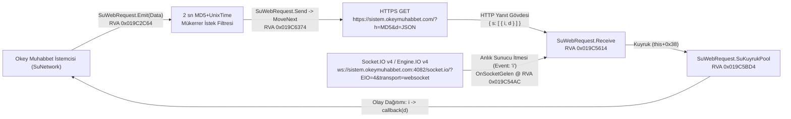

# SUNUCU BAĞLANTISI VE PROTOKOL KANITLARI (`SERVER-CONNECTION-EVIDENCE.md`)

> **Kapsam:** `com.adnc.okeymuhabbet` (`v3.1.33`) iletişim protokolü, Engine.IO / Socket.IO sürümleri, HTTPS GET + WebSocket çift kanal mimarisi, JSON mesaj zarfları ve oyun hamle şemalarının ikili kanıt dökümü.  
> **Güvenlik Notu:** APK içinde tespit edilen sabit imzalama tuzları ve el sıkışma dizgileri bu raporda `<REDACTED_...>` olarak maskelenmiş; yalnızca adresleri, uzunlukları ve protokoldeki teknik işlevleri belgelenmiştir.

---

## 1. Gerçek Ağ Mimarisi: Asimetrik Çift Taşıma (`KANITLANDI`)

Önceki metin tabanlı incelemelerin aksine, Ghidra 12.1.4 decompile çıktısı oyunun tek bir Socket.IO kanalı değil, **asimetrik çift taşıma (Dual-Transport)** mimarisi kullandığını kesin olarak kanıtlamaktadır:



---

## 2. Sunucu Uç Noktaları ve Sahne Serileştirme Kanıtları (`KANITLANDI`)

`com.adnc.okeymuhabbet.apk!/assets/bin/Data/data.unity3d` (`UnityFS` v8, Unity `6000.5.0f1`) LZ4 blokları açıldığında (`244.994.501` bayt), `level1` sahnesi (`stream offset 0x4FCACD`, boyut `39.156` bayt) içinde her iki uç nokta açık metin olarak serileştirilmiştir:

| Bileşen / Alan | Sahne Düğümü & Ofset | Serileştirilmiş Değer | Ek Serileştirilmiş Parametreler | Kanıt |
|---|---|---|---|---|
| `SocketIOClient.serverAddress` (`Field[44860]` / `EngineIOClient.serverAddress` `Field[44917]`) | `level1+0x7879` (akış `0x50433C..0x504364`) | `"ws://sistem.okeymuhabbet.com:4082"` (`len = 0x21 = 33`) | `volatileOperationMode = 1` (`0x504364`), `maxConnectAttempts = 10` (`0x504378`), `raisingReconnectDelay = 1` (`0x50437C`) | `KANITLANDI` |
| `SuWebRequest.url` (`Field[30096]`, nesne ofseti `this+0x20`) | `level1+0x7DBC` (akış `0x50487C..0x5048A4`) | `"https://sistem.okeymuhabbet.com/"` (`len = 0x20 = 32`) | `UnityEvent` bağlantısı: `SuWebRequest::SocketBaglan` (`level1+0x6F80` / akış `0x503A4D`) | `KANITLANDI` |
| `SuUpdateServerSettings` (`SuUpdateServerSettings..ctor @ RVA 0x019E6078`) | `resources.assets` (`0xB68FAD`) | `"https://update-okey.mancgames.com/android/"` | Yedek: `"https://update.okeymuhabbet.com/android/"` | `KANITLANDI` |

> **TLS / Şifreleme Gözlemi (`KANITLANDI`):** Komut kanalı TLS üzerinden (`https://sistem.okeymuhabbet.com/`) çalışırken, Socket.IO gerçek zamanlı bildirim kanalı şifresiz WebSocket (`ws://sistem.okeymuhabbet.com:4082`, port `4082`) olarak yapılandırılmıştır (`AndroidManifest.xml` içinde `android:usesCleartextTraffic="true"` bu nedenle açıktır).

---

## 3. Socket.IO ve Engine.IO Protokol Sürümü Kanıtları (`KANITLANDI`)

`Firesplash.GameDevAssets.SocketIOPlus.dll` (`Image[34]`, `Il2CppCodeGenModule @ VA 0x37F5758`) içindeki metotların Ghidra decompile ve string literal incelemesi:

1. **Engine.IO Sürümü = `4` (`EIO=4`) ve Yalnızca WebSocket Taşıması (`KANITLANDI`):**
   - **Metot:** `Firesplash.GameDevAssets.SocketIOPlus.EngineIO.Tranceiver.Connect(string serverAddress, bool volatileMode)` (`RVA 0x01ACF57C`, GhidraVA `0x01BCF57C`).
   - **Davranış:** `http://` veya `https://` şemasını `ws://` / `wss://` şemasına dönüştürür (`0x01BCF610..0x01BCF634`), yol belirtilmemişse varsayılan yolu ekler ve sorgu parametrelerine sabit olarak şunları yazar (`decompiled_targets.c` satır `290-292` + `s_MetadataUsages`):
     - `'EIO'` (`0x3ABC998`) = `'4'` (`0x3AB7738`)
     - `'transport'` (`0x3AD3AA8`) = `'websocket'` (`0x3AD4788`)
   - **HTTP Polling Yokluğu:** `NativeImplementation.Connect` (`RVA 0x01ACF3EC`) ve `<<Connect>b__0>d.MoveNext` (`RVA 0x01AD00C4`) doğrudan `.NET ClientWebSocket` (`'Connecting to WebSocket on '`, `'Starting Engine.IO Reader-Thread'`, `'Starting Engine.IO Writer-Thread'`) başlatır; HTTP long-polling fallback kodu mevcut değildir (`KANITLANDI`).
2. **Yol (Path) = `/socket.io/` (`KANITLANDI`):**
   - `Tranceiver..ctor` varsayılan olarak `'/engine.io/'` (`0x3AB6DE8`) alsa da `SocketIOClient.Awake` (`RVA 0x01AC8848`, GhidraVA `0x01BC8848`, `decompiled_targets.c` satır `770-771`) `this+0x28` (`defaultPath`) alanını **`'/socket.io/'`** (`0x3AB6EA0`) ile ezer.
   - Böylece oluşturulan tam bağlantı URI'si:
     ```text
     ws://sistem.okeymuhabbet.com:4082/socket.io/?EIO=4&transport=websocket
     ```
3. **Socket.IO Sürümü = v4.x (Socket.IO Protocol v5) (`KANITLANDI`):**
   - `SocketIONamespace.Submit` (`RVA 0x01ACA854`) sunucudan gelen ad alanı `CONNECT` (`40`) paketinin JSON yükünde `'sid'` (`0x3AD2AD0`) alanını zorunlu tutar (`'Received connect packet without sid payload. This is a server-side protocol violation.'` @ `0x3AC4108`). Ad alanı düzeyinde `sid` içeren JSON `CONNECT` paketi (`40{"sid":"..."}`) Socket.IO v4 (Protokol revizyonu 5) özelliğidir.
4. **Socket.IO Ad Alanı Kimlik Doğrulaması ve Olay Abonelikleri (`KANITLANDI`):**
   - `SuWebRequest.SocketBaglan()` (`RVA 0x019C4E04`) `SocketIOClient.SetAuthPayloadCallback` alanına (`lVar5 + 0xA8`) `SuWebRequest.Callback(namespacepath)` (`RVA 0x019C5090`) delegesini atar.
   - `SuWebRequest.Callback` (`RVA 0x019C5090`) `/` ad alanına bağlanırken (`40{...}` paketi) oyuncu `'id'` değerini (`lit#13568`) ve `lit#399` (`10` karakterlik sabit el sıkışma dizgisi: `<REDACTED_10CHAR_HANDSHAKE_SECRET>`) değerini içeren auth nesnesi üretir.
   - `SuWebRequest.Start()` (`RVA 0x019C4BE0`) varsayılan ad alanında (`SocketIOClient.D` -> `'/'`) yalnızca **4 olaya** abone olur:
     1. `'connect'` -> `SuWebRequest.OnConnect` (`RVA 0x019C51B8`): `'LoadingPanel'` / `LoadingTiles.Out()` kapatır ve `SuNetwork.GirisKontrol()` (`RVA 0x019AFD38`) çağırır.
     2. `'close'` -> `SuWebRequest.OnClose` (`RVA 0x019C5400`).
     3. `'ping'` -> `SuWebRequest.OnPing` (`RVA 0x019C5444`): `SocketIOClient.D.Emit("pong", ...)` gönderir.
     4. `'i'` -> `SuWebRequest.OnSocketGelen` (`RVA 0x019C54AC`): Gelen JSON metnini doğrudan `SuWebRequest.Receive(Data)` (`RVA 0x019C5614`) metoduna aktarır.

---

## 4. Giden Komut Kanalı (HTTPS GET) ve JSON Çerçeveleme (`KANITLANDI`)

### 4.1 `SuWebRequest.Emit(JSONObject Data)` (`RVA 0x019C2C64`, GhidraVA `0x01AC2C64`)
`decompiled_targets.c` satır `2050-2110` incelemesi:
1. `DateTime.UtcNow` üzerinden saniye cinsinden zaman damgasını (`lVar4`) hesaplar (`0x02C171AC` -> `0x02C19EA0` -> `0x02C1BFAC`).
2. `uVar3 = OyunMotoru.MD5Hash(Data.ToString())` hesaplar.
3. Mükerrer gönderim filtresi uygular:
   - Eğer `this->lastHash != uVar3` (`param_1 + 0x48`) **veya** `this->lastTime + 1 < lVar4` (`param_1 + 0x50`, yani son gönderimden en az 2 saniye geçtiyse):
   - `SuWebRequest.Send(this, Data)` (`RVA 0x019C5D88`) coroutine'ini `MonoBehaviour.StartCoroutine` (`0x035F1A68`) ile başlatır ve `lastHash` / `lastTime` alanlarını günceller.

### 4.2 `<Send>d__27.MoveNext()` (`RVA 0x019C6374`, GhidraVA `0x01AC6374`)
`decompiled_targets.c` satır `2145-2277` incelemesi:
1. **Oturum Anahtarı Enjeksiyonu:** `PlayerPrefs.HasKey("session_id")` (`0x035E8074`) doğruysa `PlayerPrefs.GetString("session_id")` (`0x035E802C`) değerini okur ve JSON nesnesine **`"_t"`** (`lit#11453`) alanıyla ekler (`JSONObject.AddField("_t", session_id)`).
2. **İstek İmzası (`?h=`):** `jsonStr = Data.ToString()` dizgisinin sonuna `lit#1429` (`16` karakterlik gömülü sabit tuz: `<REDACTED_16CHAR_STATIC_SALT>`) eklenir (`String.Concat2` @ `0x02AC02F8`) ve `h = OyunMotoru.MD5Hash(jsonStr + <REDACTED_16CHAR_STATIC_SALT>)` hesaplanır (`32` karakter küçük harf onaltılık MD5, `'x2'` formatı @ `RVA 0x01996CA8`).
3. **Tam HTTPS GET İsteği:** 5 parçalı dizgi birleştirilerek (`String.Concat` @ `0x02ACB100`) `UnityWebRequest.Get` (`0x038BF180`) + `SendWebRequest` (`0x038BD870`) çağrılır:
   ```text
   GET https://sistem.okeymuhabbet.com/?h=<md5(jsonStr + REDACTED_SALT)>&d=<jsonStr>
   ```
4. **Yanıt İşleme:** HTTP yanıt metni (`DownloadHandler.get_text` @ `0x038BC0BC`) boş değilse doğrudan `SuWebRequest.Receive(this, responseText)` (`RVA 0x019C5614`) metoduna verilir.

---

## 5. Gelen Mesaj Zarfı ve Olay Dağıtıcısı (`KANITLANDI`)

`SuWebRequest.Receive(string Data)` (`RVA 0x019C5614`, satır `2211-2422`) ve `SuWebRequest.SuKuyrukPool()` (`RVA 0x019C5BD4`, satır `2545-2621`) metotlarına göre hem HTTPS GET yanıtları hem de Socket.IO `'i'` olayları **birebir aynı JSON şemasını** kullanır:

```json
{
  "s": [
    {
      "i": "OlayAdi",
      "d": {
        "...": "..."
      }
    }
  ]
}
```

- `Receive`: Gelen metindeki ters eğik çizgileri temizler (`Data.Replace("\\", "")`), `JSONObject.Parse` ile ayrıştırır, kök nesnedeki **`"s"`** (`lit#15180`) dizisini alır, öğeleri sıralayıp `this->kuyruk` (`this + 0x38`) listesine ekler.
- `SuKuyrukPool` (`SuWebRequest.Update` tarafından her karede çağrılır): Kuyruğun başındaki öğeyi çeker, **`"i"`** (`lit#13546`) alanındaki olay adını `this->events` (`this + 0x30`) sözlüğünde arar (bu sözlüğe `SuNetwork.Start @ RVA 0x019ABDB0` içinde `120+` olay kaydedilmiştir) ve kayıtlı `Action<JSONObject>` geri çağrısına **`"d"`** (`lit#12483`) alt nesnesini parametre olarak geçirir.

---

## 6. Altı Temel Oyun İşleminin Birebir Mesaj Şemaları (`KANITLANDI`)

### 6.1 Taş Çekme (`SuNetwork.TasCek @ RVA 0x019B8DD0`)
- **Giden JSON:**
  ```json
  {
    "tip": "o",
    "dc": "0",
    "_i": "masatascek-tascek",
    "_t": "<session_id>"
  }
  ```
  - `tip`: `"o"` = orta desteden taş çekme (`'TasCek'`), `"m"` = sol oyuncunun attığı taşı yerden alma (`'TasCekMasa'`) (`Masa.TasHareketleri @ 0x019FECF0, 0x019FED9C`).
  - `dc`: `"1"` = çift tıklama ile çekme, `"0"` = sürükleyerek çekme.
- **Gelen Olay (`"i": "TasCek"` -> `Masa.TasCek @ RVA 0x01A02C7C`):**
  - Okunan `"d"` alanları (`JSONObject.DataGet`): `"tas"` (çekilen taş kimliği), `"yon"` (çeken koltuk yönü), `"tip"`, `"kt"` (kalan taş sayısı), `"tc"`, `"dc"`, `"cl"`, `"m"`.

### 6.2 Taş Atma (`SuNetwork.TasAt @ RVA 0x019B8B6C`)
- **Giden JSON:**
  ```json
  {
    "tas": "<TasKimligi>",
    "gon": "1",
    "_i": "masatasat-tasat",
    "_t": "<session_id>"
  }
  ```
- **Gelen Olay (`"i": "TasAt"` -> `Masa.TasAt @ RVA 0x01A02728`):**
  - Okunan `"d"` alanları: `"tas"`, `"yon"`, `"ms"`, `"tc"`, `"cl"` — ardından sıradaki oyuncu için `Masa_Object.SiraGeldi` ve `Masa.SureBaslat` tetiklenir.

### 6.3 Istaka Otomatik Dizme / Seri-Çift Diz (`SuNetwork.PerDiz @ RVA 0x019B8A50`)
- **Mimari Gerçek:** Okey Muhabbet klasik Düz Okey olduğundan oyunda 101 Okey tarzı masaya per açma yoktur. Oyuncu tur boyunca ıstakasındaki 28 yuvayı yerel olarak istediği gibi dizebilir (`Akıllı Diz` için ağ isteği bile gerekmez). Ayrıca sunucu destekli dizme komutu da mevcuttur:
- **Giden JSON:**
  ```json
  {
    "tip": "<Per_veya_Cift_Tipi>",
    "_i": "masaseridiz-perdiz",
    "_t": "<session_id>"
  }
  ```
- **Gelen Olay (`"i": "PerDiz"` -> `Masa.PerDiz @ RVA 0x01A03B4C`):**
  - `"d"["Taslar"]` sözlüğünden taşların hedef `"IstakaSlot"` indekslerini okur ve `Masa.TasSlotDegistir` ile taşları yuvalara yerleştirir.

### 6.4 Çifte Gitme (`SuNetwork.CifteGit @ RVA 0x019C1D4C`)
- **Giden JSON:**
  ```json
  {
    "_i": "masacift-ciftegit",
    "_t": "<session_id>"
  }
  ```
- **Gelen Olaylar:** `"CifteGit"` (`OnCifteGit @ RVA 0x019C1E20`) ve `"CiftAc"` (`OnCiftAc @ RVA 0x019B910C` -> `Masa.TaslarYerine`).

### 6.5 Oyun Bitirme ve 6.6 Okey ile Bitme (`Masa.OyunBitir @ RVA 0x019FF938` -> `SuNetwork.OyunBitirBeta @ RVA 0x019B7BEC`)
- **Ölü Kod Notu:** `SuNetwork.OyunBitir` (`RVA 0x019B7A9C`, `"masaoyunbitir-oyunbitir"`) hiçbir metottan çağrılmaz (`0 caller`). Aktif metot `SuNetwork.OyunBitirBeta` (`RVA 0x019B7BEC`) metodudur.
- **`TasListe` (`"taslar"`) Kodlaması (`decompiled_targets.c` satır `13930-14008`):** `Masa.OyunBitir` oyuncunun ıstakasındaki (`param_3 + 0x58`) tüm yuvaları sırayla tarar; dolu yuvalarda taşın kimliğini (`Tas_Object` kimlik dizgisi), boş yuvalarda **`"Bos"`** (`lit#2666`) sabitini **`"-"`** (`lit#943`) ayracıyla birleştirir.
- **Giden JSON (Normal Bitiş ve Okey ile Bitiş Ortak Komutu):**
  ```json
  {
    "taslar": "-<Slot1>-<Slot2>-Bos-<Slot4>-...",
    "bitentas": "<AtilanBitisTasiKimligi>",
    "_i": "masaoyunbitir-oyunbitirbeta",
    "_t": "<session_id>"
  }
  ```
- **Okey ile Bitme (`OkeyBitis`) Mekanizması (`KANITLANDI`):**
  - Sahnedeki `'OkeyBitis'` nesnesi (`GameObject.Find("OkeyBitis")` @ `Istaka.IstakaOlustur RVA 0x01A08F78` ve `Masa.TasCek RVA 0x01A02C7C`) gösterge taşının üzerindeki bitiş bırakma alanıdır.
  - Oyuncu 15. taşını bu alana bıraktığında `Masa.TasHareketleri` (`0x019FEF54`: `'Bitiriliyor...'`) -> `Masa.OyunBitir(tas)` -> `SuNetwork.OyunBitirBeta(TasListe, tas)` çağrılır.
  - Bırakılan `"bitentas"` aktif Okey taşı (`OkeyTas`) ise ve `"taslar"` içindeki kalan 14 taş geçerli perler veya 7 çift oluşturuyorsa sunucu Okey ile bitiş puanını hesaplayarak `"OyunBitir"` / `"OyunBitirTurnuva"` yayınlar; dizilim geçersizse `"OyunBitirHata"` (`{"hata": "..."}` -> `OnOyunBitirHata @ RVA 0x019BA8D4`) döndürür.
