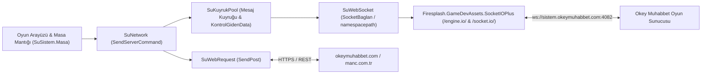

# Okey Muhabbet (`com.adnc.okeymuhabbet`) — Sunucu Protokolü ve Oyun Modeli Bulguları

**Tarih:** 17.11.2026  
**Kaynak Kanıtlar:** `ScriptingAssemblies.json`, `global-metadata.dat` (Unity `6000.5.0f1` IL2CPP v106), `data.unity3d` (`UnityFS` LZ4 akışı)  
**Çalışma Sınırı Notu:** Bu belgedeki tüm bulgular yalnızca yetkili statik paket analizinden elde edilmiştir; canlı sunucuya hiçbir izinsiz bağlantı, trafik tekrarı (replay) veya fuzzing yapılmamıştır.

---

## 1. Sunucu Topolojisi ve Uç Noktalar

| Katman / Servis | Tespit Edilen Uç Nokta / Bileşen | Rolü | Güvenirlik Statüsü |
|---|---|---|---|
| **Gerçek Zamanlı Oyun Sunucusu** | `ws://sistem.okeymuhabbet.com:4082` (`data.unity3d @ 0x17F81A`) | Lobi, masa, taş dağıtımı, hamleler, sohbet ve turnuva iletişimi | `[KANITLANDI]` |
| **WSS / TLS Yükseltme Durumu** | `Firesplash.SocketIOPlus` hem `ws://` hem `wss://` destekler; çalışma zamanında yönlendirme ile `wss://` kullanılıp kullanılmadığı | Üretim ortamında şifreli/şifresiz WebSocket seçimi | `[BİLİNMİYOR]` *(Canlı bağlantı yapılmadı)* |
| **Yönlendirme / Web Geçidi** | `http://okey.manc.com.tr/redirect/` | Uygulama içi yönlendirme / derin bağlantı (deeplink) | `[KANITLANDI]` |
| **Statik Görsel / Medya Sunucusu** | `https://www.okeymuhabbet.com/storage/img/` | Avatar, kampanya ve sunucu görselleri (`ServerImage` / `DownloadImage`) | `[KANITLANDI]` |
| **AssetBundle CDN (Android/iOS)** | `https://update-okey.mancgames.com/android/` (`/ios/`) | `SuUpdateControl` üzerinden oyun içi varlık ve `HashList` güncellemesi | `[KANITLANDI]` |
| **Sesli Sohbet (VoIP)** | `Unity.Services.Vivox.dll` (`VivoxControl`, `vivMtuServer`) | Masa içi oyuncu ve misafir sesli konuşma kanalları | `[KANITLANDI]` |

---

## 2. Taşıma ve Serileştirme Katmanı (`SuNetwork` Mimarisi)

- **`[KANITLANDI]`** **Socket.IO İstemcisi:** `Firesplash.GameDevAssets.SocketIOPlus.dll` (`[82808..83040]`) Engine.IO v4 / Socket.IO v3–v4 protokolünü uygular (`/engine.io/`, `/socket.io/` yolları sabitler tablosunda doğrulandı).
- **`[KANITLANDI]`** **Ağ Yöneticisi (`SuNetwork` & `SuWebSocket`):**
  - Bağlantı yaşam döngüsü: `SocketBaglan`, `SocketCikis`, `ReconnectAvailable`, `canReconnect`, `CheckIfSocketAlive`, `OnConnect`, `OnDisConnect`, `OnClose`, `OnPing`.
  - Kuyruklama ve hız denetimi: `SuKuyrukPool`, `Kuyruk`, `KontrolGidenData`, `KontrolGidenSure`, `SuPoolPingStatus`.
  - Olay dinleme ve gönderme: `SuOn`, `OlayAdi`, `OnSocketGelen`, `SendServerCommand`, `SendPost`.
- **`[KANITLANDI]`** **JSON Serileştirme:** Mesaj yükleri `JSONObject` (`AddJSONConents`, `GetFieldResponse`, `Stringify`, `ToDictionary`) ve `Newtonsoft.Json.dll` kullanılarak JSON metni olarak işlenir.
- **`[GÜÇLÜ İPUCU]`** **Komut Zarfı Yapısı:** `SendServerCommand` metodu `<kategori>-<eylem>` dizgesini olay/komut kimliği olarak, beraberindeki parametreleri ise JSON nesnesi (`jsondata`) olarak iletir; sunucudan gelen yanıtlar `SuNetwork` içindeki karşılık gelen `On...` geri çağrısına (`OnMasayaGir`, `OnTasCek`, `OnTasAt`, `OnIstakayiGuncelle` vb.) yönlendirilir.
- **`[BİLİNMİYOR]`** **Tam Tel-Üstü (Wire-Level) JSON Alan Adları:** Her bir komutta gönderilen JSON anahtarlarının (ör. kısaltılmış tek harfli anahtarlar mı yoksa tam alan adları mı olduğu) kesin listesi, canlı trafik yakalanmadığı için yalnızca statik sabitlerden kısmen (`token_id`, `uid`, `gid`, `MasaID`, `tas` vb.) görülebilmektedir.

---

## 3. Doğrulanmış `<kategori>-<eylem>` Sunucu Komut Kataloğu (`[KANITLANDI]`)

`global-metadata.dat` sabitler tablosundan (`[13327..16252]`) doğrudan çıkarılan tüm uygulama komutları aşağıdadır:

### 3.1 Giriş, Kayıt, Sürüm ve Oturum Komutları
| Komut Dizgesi | İlişkili `SuNetwork` Metotları | İşlevi |
|---|---|---|
| `versiyonkontrol-versiyonkontrol` | `OnVersiyonKontrol`, `OnVersiyonMesaj`, `OnOyunuGuncelle` | İstemci sürüm uyumluluğu ve zorunlu güncelleme kontrolü |
| `giris-misafir` | `MisafirGirisi`, `OnMisafirGirisi` | Misafir oyuncu oturumu açma / oluşturma |
| `giris-googlegirisyeni` | `LoginGoogle`, `OnGoogleLogin` | Google Play Games kimliği ile giriş |
| `giris-facebookgiris` | `FacebookGiris`, `FacebookGirisOk` | Facebook erişim jetonu ile giriş |
| `giris-applegiris` | `LoginToApple` | Apple kimliği ile giriş |
| `giris-GirisYap` | `Giris`, `OnGirisYapildi`, `OnGirisYapilamadi` | Standart üye girişi |
| `uye-GirisKayit` | `GirisKayit`, `OnIlkKayit` | Yeni kullanıcı profil kaydı |
| `giris-LoginDetectAccount` | `LoginDetectAccount`, `OnLoginDetectAccount` | Cihazdaki mevcut hesabı tespit etme |
| `giris-DeleteDetectAccount` | `DeleteDetectAccount`, `OnDeleteDetectAccount` | Cihaz hesap eşleşmesini kaldırma |
| `giris-CikisYap` | `CikisYap`, `OnCikisYap` | Oturumu sonlandırma |
| `giriskontrol-UyeGirisKontrol` | `GirisKontrol` | Aktif oturum geçerlilik kontrolü |
| `oyuncu-AccountMergeNative` | `MergeAccount`, `OnMergeAccount` | Misafir hesabını kalıcı hesaba birleştirme |
| `oyun-mackayit` | `MacAdresiGonder`, `MacAddressBul` | Cihaz ağ/donanım tanımlayıcı kaydı |
| `oyunbilgileri-bilgileriyukle` | `OyunBilgileriKontrol`, `OnBilgileriYukle` | Başlangıç oda, market, seviye ve ayar tablolarını yükleme |
| `uyecron-cronmasa` | `PingCheck` / masa zamanlayıcısı | Oturum ve masa içi periyodik canlılık bildirimi (heartbeat) |
| `oyun-oyunpause` | `OyunPause` | Uygulamanın arka plana geçiş/dönüş bildirimi (`arka`) |
| `firebase-FireBaseToken` | `FireBaseToken`, `OnFireBaseTokenIste` | FCM bildirim jetonu kaydı |

### 3.2 Lobi, Oda ve Masa Yönetim Komutları
| Komut Dizgesi | İlişkili `SuNetwork` Metotları | İşlevi |
|---|---|---|
| `hemenoyna-oyna` | `Oyna` (`HemenOynaAyar`: `tek`, `esli`, `rix`, `two`/`three`/`four`) | Hızlı masa eşleştirme |
| `masayakatil-masalistesi` | `MasaListesiGetir`, `OnMasaListesi`, `OnMasaListesiPasif` | Seçili odadaki (`OdaID`) aktif/pasif masa listesini çekme |
| `masaac-masaacpanel` | `MasaAcPanel`, `OnMasaAcPanel`, `MasaAcPanelOzel` | Masa açma yapılandırma limitlerini alma |
| `masaac-MasaAc` | `MasaAc`, `OnMasaAcildi` | Yeni masa oluşturma (`KisiSayisi`, `Puan`, `Esli`, `Rix`, `Ozel`, `Misafir`) |
| `masayagir-masayagir` | `MasayaGir`, `OnMasayaGir`, `OnMasayaGirdi` | Masaya izleyici/katılımcı olarak bağlanma (`MID`) |
| `masayaotur-masayaotur` | `MasayaOtur`, `OnMasayaOtur`, `OnMasayaOturdu` | Masadaki belirli bir koltuğa (`Yon`) oturma |
| `masayaotur-masayaoturoto` | `MasayaOturOto` | Boş koltuğa otomatik oturma |
| `masadancik-masadancik` | `MasadanCik`, `OnMasadanCik`, `OnMasadanCikti` | Masadan ayrılma |
| `masakontrol-masakontrol` | `MasaAyarKontrol` | Masa durumu mutabakat kontrolü |
| `masayiguncelle-masayiguncelle` | `MasayiGuncelle`, `OnMasayiGuncelle`, `MasaNetGuncelle` | Masa ayarlarını ve oyuncu durumlarını tazeleme |
| `masamisafir-masamisafir` | `MasaMisafir` | Masadaki izleyicileri (misafirleri) yönetme |
| `masayadavet-davetlistesi` / `davetet` | `OnDavetListesi`, `DavetEt`, `OnDavetEt` | Masaya oyuncu davet etme |

### 3.3 Oyun İçi Taş, İstaka ve Hamle Komutları
| Komut Dizgesi | İlişkili `SuNetwork` / `Masa` Metotları | İşlevi |
|---|---|---|
| `masaoyunbaslat-basla` | `OyunBasla` (`Baslatabilir`) | Eli / oyunu başlatma |
| `masatascek-tascek` | `TasCek`, `OnTasCek` | Ortadan veya yan oyuncunun attığı taştan taş çekme |
| `masatasat-tasat` | `TasAt`, `OnTasAt` (`TasAdi`, `Nereden`) | İstakadan seçilen taşı atma slotuna atma |
| `masaseridiz-perdiz` | `PerDiz`, `OnPerDiz` | İstakadaki taşları seri/per düzenine göre dizme / bildirme |
| `masacift-ciftegit` | `CifteGit`, `OnCifteGit`, `OnCiftAc` | Eli çift dizilimine açma / çifte gitme |
| `masacift-yerdekitaslar` | `YerdekiTaslar`, `OnYerdekiTaslar` | Atılan/yerdeki taşların görünümünü sorgulama (izinli modlarda) |
| `masaoyunbitir-oyunbitir` | `OyunBitir`, `OnOyunBitir`, `OnOyunBitirHata`, `OnElBitis` | Gösterge/bitiş taşı atarak eli bitirme talebi (Okey ile bitiş dahil) |
| `masaoyunbitir-oyunbitirbeta` | `OyunBitirBeta` | Alternatif/güncel el bitirme doğrulama komutu |
| `rixdouble-doublebet` / `updatebet` | `RixDoubleOffer`, `RixAcceptOffer`, `OnRixDoubleOffer` | Rix modunda bahis/puan katlama teklifi ve yanıtı |
| *(Sunucu İtme Olayları)* | `OnIstakayiGuncelle`, `OnMasaTaslariGuncelle`, `OnTaslariTemizle`, `SiraGeldi` | Taş dağıtımı, ıstaka senkronizasyonu ve sıra değişimi (`[KANITLANDI]`) |

### 3.4 Turnuva, Sosyal, Ses ve Ekonomi Komutları
- **Turnuva:** `tournament-aktifturnuvalar`, `tournament-turnuvayakatil`, `tournament-TurnuvaKuyruktaBekle`, `tournament-turnuvamasasibul`, `tournament-TurnuvaHazirim`, `tournament-sendmyhand` (`SendTileCount`), `turnuva-turnuvabitis`, `turnuva-turnuvaelenme`, `turnuva-turnuvaizle`, `turnuva-ustturacik`, `kuyruk-baslat`.
- **Sosyal & Mesajlaşma:** `arkadaslar-liste`, `arkadaslar-arkadasara`, `arkadaslar-istekyanitla`, `arkadaslar-engelliste`, `arkadaslar-engelikaldir`, `arkadaslar-referanslistesi`, `oyuncu-bilgi`, `oyuncu-arkadasekle`, `oyuncu-arkadassil`, `oyuncu-engelle`, `oyuncu-sikayetet`, `oyuncu-mesajgonder`, `mesajlar-mesajlaryeni`, `masamesaj-MasayaMesajGonder`, `masamesaj-chatemojigonder`.
- **Masa İçi Ses İzni:** `misafirkonusma-konusmaistek`, `misafirkonusma-konusmakabul`, `misafirkonusma-konusmacikar`, `misafirkonusma-misafirmasadancikar`.
- **Profil, Sıralama & Ekonomi:** `profil-bilgi`, `profil-kayit`, `profil-hesabimisil`, `skorlistesi-haftalik`, `skorlistesi-aylik`, `skorlistesi-genel`, `bonusal-bonusal`, `oyun-gunlukodul`, `gorevler-odultoplandi`, `siparis-market`, `siparis-uyelik`, `siparis-hediye`, `siparis-hazineal`, `siparis-hile`.

---

## 4. Oyun Veri Modelleri ve Kural Doğrulama Mimarisi

### 4.1 Taş (`Tas_Object`) ve İstaka (`Istaka`) Modeli (`[KANITLANDI]`)
`SuSistem.Masa` altındaki özellik erişimcilerinden (`getter/setter`) doğrulanan veri alanları:
- **`Tas_Object`:**
  - `TasID` (benzersiz taş örneği kimliği — 106 taşlık destede her taşın tekil ID'si `[GÜÇLÜ İPUCU]`),
  - `TasAdi` / `TasKey` (taşın kodlanmış metin anahtarı),
  - `TasRenk` (4 renk + sahte okey ayrımı),
  - `TasSayi` / `TasRakam` (`1..13` arası sayısal değer),
  - `Okeymi` (göstergeye göre belirlenen aktif Okey/joker taşı bayrağı),
  - `TasIslek` (işlek taş / el toplamı hesaplama bayrağı),
  - `SlotID` (`Istaka` üzerindeki yuva indeksi).
- **`MasaPerHesaplayici` (Yerel Dizilim Motoru):**
  - `perGruplari`, `ciftGruplari`, `tekliGruplar`, `okeyler`,
  - `PerSeriTasSorgula` (aynı renk ardışık sayı dizisi, ör. 7-8-9),
  - `PerRenkTasSorgula` (farklı renk aynı sayı grubu, ör. Mavi 7 - Siyah 7 - Kırmızı 7),
  - `PerOkeyKontrol` (eksik taşın Okey taşıyla tamamlanması ve `OkeyMi` kontrolü),
  - `HesaplaKalanToplam` / `GetPerDisiTasToplami` / `GetCiftDisiTasToplami`.

### 4.2 Kural Doğrulaması: Sunucu mu, İstemci mi? (`[KANITLANDI]`)
1. **Gizli Bilgi (Hidden Information) Sunucudadır:** İstemcide tüm 106 taşın dizisini tutan bir deste sınıfı yoktur; yalnızca `KalanTas` (sayı), `OyuncuTaslar` (oyuncunun kendi ıstakası) ve `AtilanlariYerlestir` (atılan açık taşlar) bulunur. Oyuncu `masatascek-tascek` gönderdiğinde çekilen taşı sunucu bildirir (`OnTasCek` / `OnIstakayiGuncelle`).
2. **Sıra ve Süre Denetimi Sunucudadır:** `MasaSira`, `YetkiYon` ve `MasaSure` sunucu tarafından güncellenir (`SiraGeldi`).
3. **El Bitirme Doğrulaması Sunucudadır:** Oyuncu `masaoyunbitir-oyunbitir` gönderdiğinde sunucu oyuncunun elindeki perleri doğrular. El geçersizse sunucu **`OnOyunBitirHata`** olayını tetikler ve istemcide `BitirHata` / `PerHata` gösterilir; geçerliyse `OnOyunBitir` / `OnElBitis` ve `ElSkorIcerik` (`OyuncuPuanlar`, `OyuncuCezalar`) yayınlanır.
4. **Sonuç:** Hileli taş üretmek veya geçersiz elle oyunu bitirmek sunucu tarafından engellenmektedir; ancak istemci tarafında yerel `Akıllı Diz` (`MasaPerHesaplayici`) zaten orijinal oyunun da bir parçasıdır. Buna karşılık masadaki `Yardimli` (`get_Yardimli`) ayarı kapalıyken harici hamle/olasılık yardımı sunmak oyun kurallarına aykırıdır.
