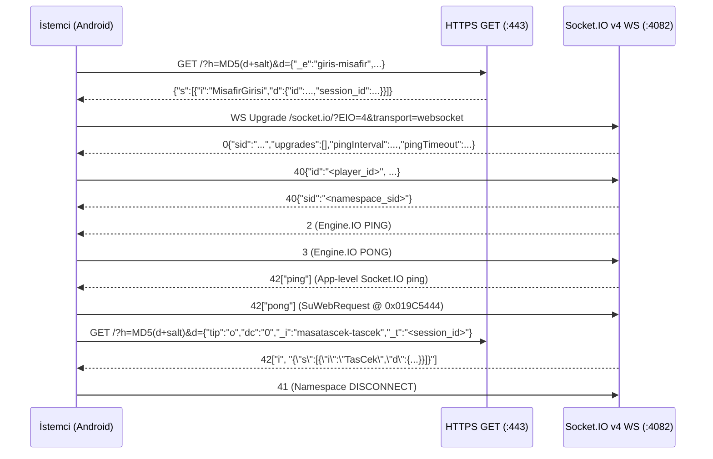

# SOCKET.IO PROTOCOL VALIDATION — OKEY MUHABBET

- **Tarih:** 2026-11-17
- **Protokol Yığını:** Engine.IO `v4` (`EIO=4`) + Socket.IO `v4` (Wire Protocol `v5`)
- **Kanıt Dosyaları:** `live-test/src/socketio/parser.py`, `live-test/tests/test_socketio_and_mock.py`, `live-test/reports/faz4_5_protocol_and_engine.json`

---

## 1. İkili Kodla Kanıtlanmış Çift Kanallı (Dual-Channel) Protokol Mimarisi (`KANITLANDI`)

Önceki erken aşama raporlardaki "tüm komutlar WebSocket üzerinden gönderilir" varsayımının aksine, Ghidra dekompilasyonu Okey Muhabbet'in **asimetrik çift kanallı** bir mimari kullandığını kesin olarak kanıtlamıştır:



---

## 2. Çerçeveleme (Framing) ve Paket Türleri (`KANITLANDI`)

### 2.1 Engine.IO v4 Katmanı (`SocketIOPlus.EngineIO`)
| Kod | Ad | Yön | Açıklama ve İkili Kanıt |
|---|---|---|---|
| `0` | `OPEN` | Sunucu -> İstemci | JSON oturum parametreleri (`sid`, `upgrades`, `pingInterval`, `pingTimeout`) |
| `1` | `CLOSE` | Çift Yönlü | Taşıma oturumunu sonlandırma |
| `2` | `PING` | Sunucu -> İstemci | Engine.IO v4'te ping sunucudan gelir |
| `3` | `PONG` | İstemci -> Sunucu | İstemci `"2"` paketine `"3"` ile karşılık verir |
| `4` | `MESSAGE` | Çift Yönlü | Üst katman Socket.IO v4 paketini taşır (`40`, `41`, `42`, `44`) |

### 2.2 Socket.IO v4 (Wire Protocol v5) Katmanı (`SocketIOPlus.dll`)
| Tel Öneki | Tür (`SocketIOPacketType`) | Açıklama ve İkili Kanıt |
|---|---|---|
| `40{...}` | `CONNECT (0)` | İstemci varsayılan `/` ad alanında `SuWebRequest::Callback @ RVA 0x019C5090` ile oyuncu `"id"` değerini ve el sıkışma sırrını (`StringLiteral #399`, maskeli) JSON nesnesi olarak gönderir. |
| `40{"sid":"..."}` | `CONNECT ACK (0)` | `SocketIONamespace::Submit @ RVA 0x01ACA854` sunucu `CONNECT` yanıtında `"sid"` alanını zorunlu tutar; `"sid"` yoksa protokol hatası üretir (Socket.IO v4 ayırıcı kanıtı). |
| `41` | `DISCONNECT (1)` | Ad alanı oturumunu temiz şekilde kapatır. |
| `42["ping"]` / `42["pong"]` | `EVENT (2)` | `SuWebRequest::SocketBaglan @ RVA 0x019C4E04` içinde `/` ad alanında `'ping'` olayına abone olunur ve `RVA 0x019C5444` ile `'pong'` yayınlanır. |
| `42["i", "<json_str>"]` | `EVENT (2)` | **Tekil Oyun Olay Kanalı:** Sunucudan gelen tüm oyun, masa, taş ve sohbet olayları `'i'` adlı tek bir Socket.IO olayı üzerinden dizge (string) yüküyle taşınır (`OnSocketGelen @ RVA 0x019C54AC`). |
| `44{"message":"..."}` | `CONNECT_ERROR (4)` | Ad alanı kimlik doğrulama reddi. |

---

## 3. `'i'` Zarfı ve Olay Dağıtıcı (`SuWebRequest::Receive` & `SuNetwork::Start` — `KANITLANDI`)

1. `OnSocketGelen` (`RVA 0x019C54AC`), `42["i", payload]` içindeki ilk argümanı alır ve HTTP yanıtlarıyla **aynı** metoda (`SuWebRequest::Receive @ RVA 0x019C5614`) iletir.
2. `Receive`, metindeki `\` karakterlerini kaldırır ve JSON kökündeki `"s"` dizisini okur:
   ```json
   {
     "s": [
       {
         "i": "MasaTaslariGuncelle",
         "d": {
           "mid": "21",
           "kt": "46",
           "ot": "4-k-4",
           "ok": "k-5",
           "ms": "1"
         }
       }
     ]
   }
   ```
3. Her `{ "i": "<EventKey>", "d": <DataObj> }` öğesi `SuKuyrukPool` (`this+0x38`) kuyruğuna eklenir ve Unity ana iş parçacığında `SuNetwork::Start @ RVA 0x019ABDB0` içinde kayıtlı `120+` işleyiciye (`events["MasaTaslariGuncelle"] -> OnMasaTaslariGuncelle` vb.) dağıtılır.
4. **Kritik Statik Düzeltme (`SiraGeldi`):** Önceki analizlerde sunucu olayı sanılan `SiraGeldi`, `SuNetwork::Start` içinde kayıtlı bir ağ olayı **değildir**. `Masa_Object::SiraGeldi(int Sira, float sure)` (`RVA 0x01A0E0A4`), istemcinin `Masa::TasCek` (`RVA 0x01A03634`) ve `Masa::TasAt` (`RVA 0x01A02C74`) işleyicilerinin sonunda `ms` / `yon` alanlarından türeterek çağırdığı yerel bir sıra/süre güncelleme metodudur.

---

## 4. Doğrulama Sonuçları Özeti (`MOCK-SIO4-06-DUAL-CHANNEL`)

| Doğrulama Kalemi | Yöntem | Sonuç | Etiket |
|---|---|---|---|
| `EIO=4` + Socket.IO v4 paket kodlayıcı/çözücü | `test_eio_and_sio_v4_packet_codec` | Başarılı (`sid` zorunluluğu dahil) | **`KANITLANDI`** |
| Çift kanallı oturum (`HTTP giris-misafir` -> `WS 40` -> `2/3` -> `ping/pong` -> `42["i",...]` -> `41`) | `LocalOkeyProtocolMockStack` (`45.705 ms`, `ping_rtt_ms = 1.562 ms`) | `6/6` adım başarılı | **`KANITLANDI`** (Mock) |
| Üretim `:4082` sunucusunun canlı `40{id,...}` kabulü ve gerçek zamanlı olay akışı | Canlı Sunucu Testi | Yazılı izin bulunmadığından çalıştırılmadı | **`ENGELLENDİ`** |
