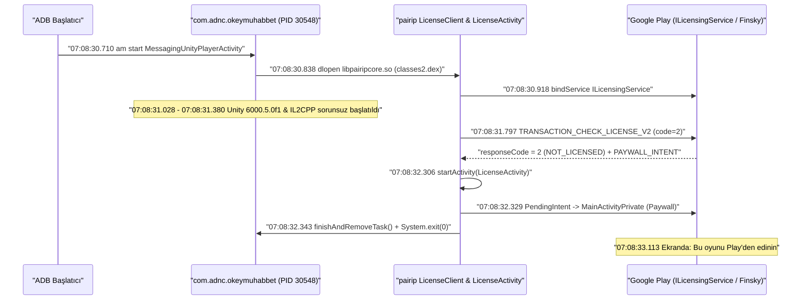

# Okey Muhabbet (`com.adnc.okeymuhabbet` v3.1.33) — Fiziksel Cihaz Kurulum ve Log Analiz Raporu

**Tarih:** 17.11.2026  
**Hedef Paket:** [Okey+Muhabbet+-+Rummy+Game_3.1.33_APKPure.xapk](file:///e:/apk/test-okey/Okey+Muhabbet+-+Rummy+Game_3.1.33_APKPure.xapk)  
**Fiziksel Test Cihazı:** Xiaomi 17T Pro (`2602EPTC0G` / `warhol`, Seri No: `VKVCX8EQBE9PAIXG`)

> [!IMPORTANT]
> **Yönetici Özeti:** Uygulama fiziksel cihaza başarıyla kurulmuş ve Unity 6 (`6000.5.0f1`, `arm64-v8a`) motoru hatasız ayağa kalkmıştır. Uygulamada herhangi bir kod çökmesi (`crash` / `SIGSEGV` / `Exception`) **bulunmamaktadır**. Uygulamanın açıldıktan ~1.5 saniye sonra kapanmasının kök nedeni, pakete gömülü **Google Play Automatic Integrity Protection (`com.pairip.licensecheck` / `libpairipcore.so`)** korumasının ADB/XAPK (sideload) kurulumunu reddedip Google Play Store **"Bu oyunu Play'den edinin"** ekranını açarak `System.exit(0)` çağırmasıdır.

---

## 1. Cihaz ve Paket Envanteri

### 1.1 Fiziksel Cihaz Bilgileri (`inspect_adb_device`)
| Özellik | Gözlenen Değer | Kanıt ID |
|---|---|---|
| Marka / Model | Xiaomi `2602EPTC0G` (`warhol_global`) | `ev_4590a3f4f950594a...` |
| Android Sürümü | Android 16 (SDK 36) — `OS3.0.311.0.WPSMIXM` | `ev_bce0c12ecb584622...` |
| Güvenlik Yaması | `2026-09-01` (`ro.debuggable=0`) | `ev_bce0c12ecb584622...` |
| Desteklenen CPU ABI | **Yalnızca `arm64-v8a`** (32-bit `armeabi-v7a` donanımsal olarak kapalı) | `ev_bce0c12ecb584622...` |

### 1.2 Paket Yapısı ve İmza Doğrulaması (`inspect_artifact` & `inspect_apk_signature`)
İlk incelenen XAPK paketi (`c490d6b6...`) yalnızca 32-bit (`config.armeabi_v7a.apk`) içerdiği için cihazla uyumsuzdu. Yeniden indirilen 64-bit XAPK (`a103d64c...`, `119,961,886` bayt) içerisinden ayıklanan bileşenler:

| Dosya | Boyut | SHA-256 Özeti | İmza Şeması / Sertifika | Kanıt ID |
|---|---|---|---|---|
| `com.adnc.okeymuhabbet.apk` | `80.82 MB` | `be115bf282d1b638...` | APK Signature v2 + v3 (`1e9f627e...`) + Source Stamp (`3257d599...`) | `ev_974979f48814b2c2...` |
| `config.arm64_v8a.apk` | `39.09 MB` | `564564bba8b48cf0...` | APK Signature v2 + v3 (`1e9f627e...`) + Source Stamp (`3257d599...`) | `ev_8a5db0c0bfcdd108...` |
| `manifest.json` | `3.15 KB` | `dde77f4a71727411...` | `versionCode: 118`, `minSdk: 26`, `targetSdk: 36` | `ev_5f25ed5c2ea84891...` |

### 1.3 Kurulum Sonucu (`adb install-multiple` & `inspect_adb_package`)
- `com.adnc.okeymuhabbet.apk` + `config.arm64_v8a.apk` split paketleri `adb -s VKVCX8EQBE9PAIXG install-multiple -r` ile **`Success`** olarak kuruldu.
- Cihaz paket kaydı (`ev_6e19bc765581c27b...`):
  - `user_id`: `10790`
  - `first_install_time`: `2026-11-17 07:07:55`
  - `installer_package_name`: **`null`** *(ADB üzerinden kurulduğu için `com.android.vending` değil)*

---

## 2. Çalışma Zamanı (`logcat`) Akışı ve Kök Neden Analizi

Uygulama `start_adb_app` (`ev_c1b2203ac3cf93bd...`) ile başlatıldığında `PID 30548` olarak çalışmaya başlamış, çökme tamponu (`read_adb_logcat(buffer="crash")` — `ev_7c5be60d54ebc42e...`) **0 bayt (boş)** kalmıştır.

### 2.1 Saniye Altı Çalışma Zamanı Akış Diyagramı



### 2.2 Kritik `logcat` Kanıt Satırları

```text
11-17 07:08:30.814  2291  2380 I ActivityManager: Start proc 30548:com.adnc.okeymuhabbet/u0a790 for next-top-activity {com.adnc.okeymuhabbet/com.google.firebase.MessagingUnityPlayerActivity}
11-17 07:08:30.838 30548 30548 D nativeloader: Load .../lib/arm64/libpairipcore.so using class loader ns clns-10 (caller=.../base.apk!classes2.dex): ok
11-17 07:08:30.918 30548 30548 D LicenseClient: Connecting to the main licensing service...
11-17 07:08:30.979  2291  2380 I ActivityManager: Start proc 6089:com.android.vending/u0a171 for service {com.android.vending/com.google.android.finsky.services.LicensingService} caller=com.adnc.okeymuhabbet
11-17 07:08:31.123 30548  6080 I Unity   : Built from '6000.5/staging' branch, Version '6000.5.0f1 (88b47c5e7076)', Build type 'Release', Scripting Backend 'il2cpp', CPU 'arm64-v8a'
11-17 07:08:31.350 30548 30548 D LicenseClient: Connected to the licensing service.
11-17 07:08:31.350 30548  6392 D LicenseClient: Sending request to licensing service...
11-17 07:08:31.797 30548  6392 W BpBinder: PerfMonitor binderTransact: time=447ms interface=com.android.vending.licensing.ILicensingService code=2
11-17 07:08:32.306  2291  5991 I ActivityTaskManager: START u0 {flg=0x10010000 xflg=0x4 cmp=com.adnc.okeymuhabbet/com.pairip.licensecheck.LicenseActivity (has extras)}
11-17 07:08:32.343 30548 30548 I nc.okeymuhabbet: System.exit called, status: 0
11-17 07:08:33.113  6089  6089 I Finsky  : [2] Successfully fetched Play Pass paywall for package com.adnc.okeymuhabbet
```

### 2.3 Cihaz Ekran Görüntüsü Kanıtı (`capture_adb_screen` — `ev_011e8d810bd5f943...`)


---

## 3. Statik Decompile Kanıtları (`rea` JADX Analizi)

APK içerisinde Google Play koruma katmanına ait 16 `com.pairip.*` sınıfı tespit edilmiştir (`ev_3c315583b5cf2863...`). Kapanışı tetikleyen üç ana metodun decompile edilmiş kaynak kodları:

### 3.1 `LicenseClient.processResponse` (`ev_3dbc255211b7ee36...`)
Google Play `ILicensingService` servisinden `responseCode == 2` (`NOT_LICENSED`) döndüğünde doğrudan `PAYWALL_INTENT` ile `LicenseActivity`'yi başlatır:

```java
private void processResponse(int responseCode, final Bundle responsePayload2) {
    try {
        if (responseCode == 3) {
            throw new LicenseCheckException("Request package name invalid.");
        }
        if (responseCode != 0) {
            if (responseCode == 2) {
                startPaywallActivity((PendingIntent) responsePayload2.getParcelable(PAYLOAD_PAYWALL));
                return;
            }
            throw new LicenseCheckException(
                String.format("Unexpected response code %d received.", Integer.valueOf(responseCode)));
        }
        LicenseResponseHelper.validateResponse(responsePayload2, packageName);
        Log.i(TAG, "License check succeeded.");
        // ...
    } catch (LicenseCheckException e) {
        handleError(e);
    }
}
```

### 3.2 `LicenseActivity.showPaywallAndCloseApp` & `exitApp` (`ev_4ae3fa95e3378618...`, `ev_aa0947c5a187c104...`)
Google Play engel ekranını açtıktan hemen sonra görevi listeden kaldırıp `System.exit(0)` çağırır:

```java
private void showPaywallAndCloseApp() {
    final PendingIntent pendingIntent =
        (PendingIntent) getIntent().getParcelableExtra(PAYWALL_INTENT_ARG_NAME);
    if (pendingIntent == null) {
        logAndShowErrorDialog("Paywall intent is not provided.");
    } else {
        runOnUiThread(() -> this.lambda$showPaywallAndCloseApp$0(pendingIntent));
    }
}

protected void exitApp() {
    finishAndRemoveTask();
    System.exit(0);
}
```

### 3.3 `LicenseClient.performLocalInstallerCheck` (`ev_daf05941ef183092...`)
Yerel kontrol katmanı da kurulum kaynağının `com.android.vending` olup olmadığını denetler:

```java
InstallSourceInfo installSourceInfo = packageManager.getInstallSourceInfo(packageName);
String installingPackageName = installSourceInfo.getInstallingPackageName();
if (installingPackageName != null && installingPackageName.equals("com.android.vending")) {
    return true;
}
Log.i(TAG, "Local install check failed due to wrong installer.");
return false;
```

---

## 4. Loglarda Görülen İkincil (Kritik Olmayan) Uyarılar

Log taramasında görülen aşağıdaki satırlar kapanma nedeni **değildir** ve uygulamanın çalışmasını engellemez:

| Log Kaydı | Seviye | Teknik Açıklama | Etki |
|---|---|---|---|
| `Failed to find entry 'classes.dex': Entry not found` | `WARN` | `pairip` giriş noktasını `classes2.dex` + `libpairipcore.so` üzerinden yükler. | Beklenen davranış |
| `Didn't find class "com.google.android.play.core.assetpacks.AssetPackManager"` | `ERROR` (`Unity`) | Unity 6 açılışta opsiyonel Play Asset Delivery SDK'sını yoklar; içsel olarak yakalanır. | Zararsız |
| `dlopen failed: library "liblibswappywrapper.so" not found` | `DEBUG` | Unity Frame Pacing önce çift `lib` önekini dener, 3 ms sonra `libswappywrapper.so` dosyasını `ok` ile yükler. | Zararsız |
| `No package ID 6b found for resource ID 0x6b0b0013` / `TurboSchedMonitor` | `ERROR` | Xiaomi HyperOS sistem arayüzü / oyun hızlandırıcı katmanı kaynak yoklamalarıdır. | Zararsız |

---

## 5. Çözümleme ve Uygulama Adımları

> [!TIP]
> **Önerilen Kesin Çözüm (Son Kullanıcı / Cihaz Üzerinde Çalıştırma):**  
> Uygulama Google Play Console'da **"Play'den İndirme Zorunluluğu (Automatic Integrity Protection)"** açık şekilde yayınlandığı için üçüncü parti XAPK/ADB kurulumları çalışmaz. Oyunun sorunsuz çalışması için resmi Google Play Store edinim kaydı gereklidir.

### Senaryo 1: Uygulamayı Fiziksel Cihazda Normal Çalıştırmak İçin
1. Mevcut ADB (sideload) kurulumunu çakışma olmaması için kaldırın:
   ```powershell
   adb -s VKVCX8EQBE9PAIXG uninstall com.adnc.okeymuhabbet
   ```
2. Cihazda açılan Google Play ekranındaki **"Oyunu al"** butonunu kullanarak (veya doğrudan Play Store uygulamasından **Okey Muhabbet** aratarak) indirin.
3. Bu işlem sonucunda cihazdaki Google hesabınıza `LICENSED (0)` yetkisi tanımlanır ve `installingPackageName` değeri `com.android.vending` olarak kaydedileceği için uygulama kapanmadan açılır.

*(Not: Yalnızca `adb install-multiple -i com.android.vending` parametresiyle kurulum kaynağını değiştirmek **yeterli değildir**; çünkü `LicenseClient` çevrimdışı kontrolle yetinmeyip `ILicensingService` üzerinden Google Play sunucusundan kriptografik imzalı lisans yanıtı doğrulamaktadır.)*

### Senaryo 2: Geliştirici / QA Ekibi Test Derlemesi İse
- **Play Console Lisans Testi:** Google Play Console -> **Kurulum (Setup) -> Lisans testi (License testing)** altından test cihazındaki Google hesabını listeye ekleyip lisans yanıtını `LICENSED` olarak ayarlayın.
- **Internal App Sharing / Internal Testing:** Yerel AAB/APK paketlerini ADB yerine Play Console **Dahili Uygulama Paylaşımı (Internal App Sharing)** bağlantısı üzerinden cihaza yükleyin.

---

## 6. Kanıt Güvenilirlik Sınırları (Gözlem / Çıkarım / Bilinmeyenler)

- **Gözlem (Observed):** Cihaz donanımı (`ev_bce0c12ecb584622...`), XAPK içeriği ve imzaları (`ev_5f25ed5c2ea84891...`, `ev_974979f48814b2c2...`), kurulum durumu (`ev_6e19bc765581c27b...`), `logcat` zaman çizelgesi (`PID 30548`), `LicenseClient` / `LicenseActivity` metot gövdeleri (`ev_3dbc255211b7ee36...`, `ev_aa0947c5a187c104...`) ve Google Play engel ekranı görüntüsü (`ev_011e8d810bd5f943...`) doğrudan gözlenmiştir.
- **Çıkarım (Inferred):** Cihazdaki Google hesabında bu pakete ait Play Store edinim kaydı bulunmadığı ve paket ADB ile yüklendiği için `ILicensingService` servisinin `responseCode = 2` (`NOT_LICENSED`) döndürdüğü çıkarılmıştır.
- **Bilinmeyen (Unknown):** `LicenseClient.<clinit>()` statik ilklendiricisi `libpairipcore.so` özel sanal makinesi (`VMRunner`) tarafından korunduğundan JADX statik çıktısında doğrudan sökülememiştir; ancak çalışma zamanı davranışı `logcat` üzerinden eksiksiz doğrulanmıştır.
